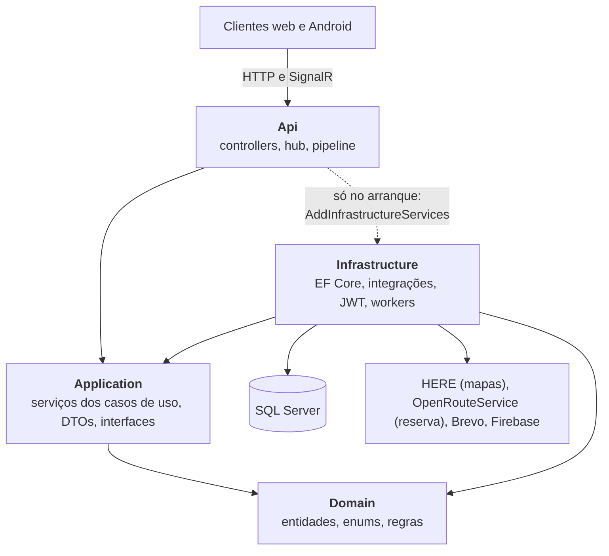
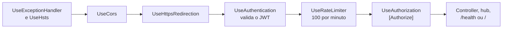
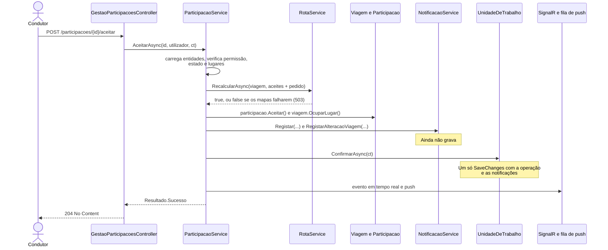
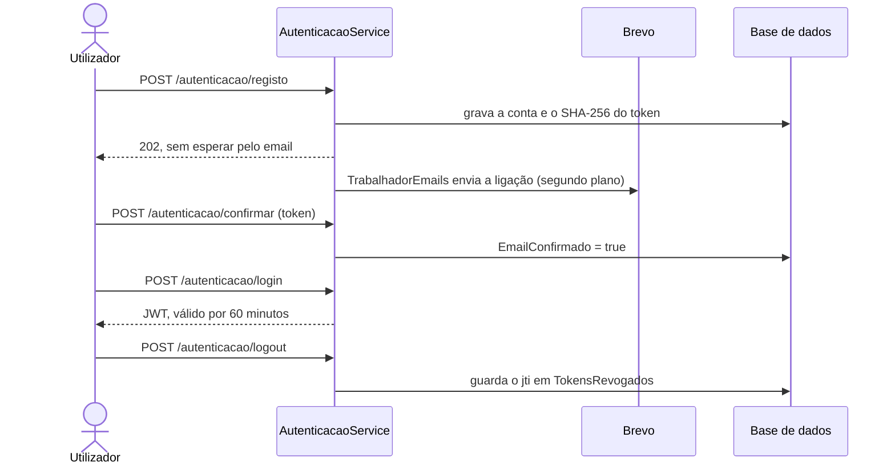
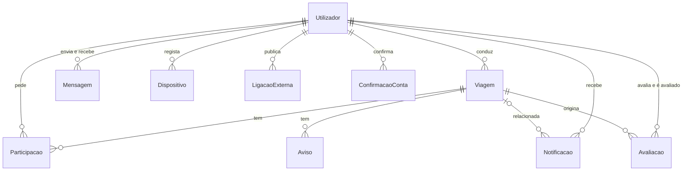
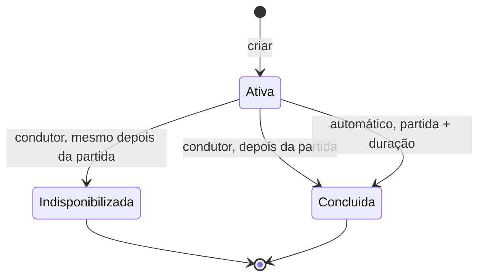
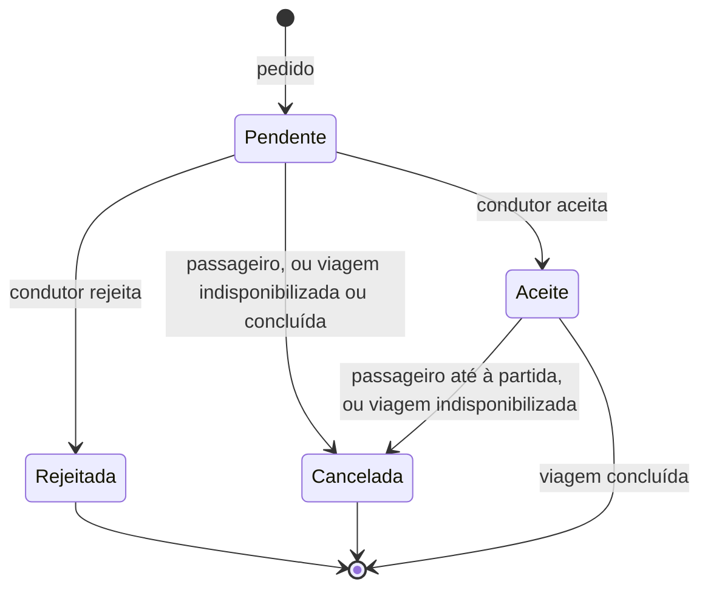

# Guia do código do backend

Para quem vai ler, corrigir ou acrescentar código ao backend do Campus Carpool sem o ter escrito. Explica como as peças encaixam e onde procurar; o detalhe de cada classe está nos comentários XML do próprio código.

Descreve o código entregue em m3 (I110, 06/11/2026) com as correções e melhorias da I112 (branch `fix/i112-corrigir-melhorar-backend`, 16 e 17/11/2026: HERE como fornecedor principal, simulações com mapa e listas paginadas). **Quando este guia e o código divergirem, vale o código.**

**Referências usadas no texto:** `RF-Fnnn-nn`, `RNF-…` e `P-nn` são requisitos e pressupostos da especificação; `UC-Fnnn-nn` são casos de uso; `AD-001` a `AD-003` são os documentos adicionais sobre estados, rotas e permissões. `DEF-BE-nnn` são defeitos da RTM. `DC-nn`, `API-nn`, `DO-nn`, `AP-nn`, `IN-nn` e `C1` são achados da revisão do backend, e aparecem assim nos comentários do código.

## Conteúdo

1. [Mapa do código](#1-mapa-do-código)
2. [Um pedido do início ao fim](#2-um-pedido-do-início-ao-fim)
3. [Autenticação](#3-autenticação)
4. [Notificações e tempo real](#4-notificações-e-tempo-real)
5. [Modelo de dados e entidades](#5-modelo-de-dados-e-entidades)
6. [Ciclo de vida da viagem e da participação](#6-ciclo-de-vida-da-viagem-e-da-participação)
7. [Rotas e Serviço de Mapas](#7-rotas-e-serviço-de-mapas)
8. [Onde está cada funcionalidade](#8-onde-está-cada-funcionalidade)
9. [Armadilhas](#9-armadilhas)
10. [Limitações conhecidas](#10-limitações-conhecidas)
11. [Como correr](#11-como-correr)
12. [Como testar](#12-como-testar)
13. [Frontend mobile](#13-frontend-mobile)

## 1. Mapa do código

Todo o código está em `backend/`, numa solução .NET 10 (`CampusCarpool.slnx`) com quatro projetos em `src/` e um de testes em `tests/`.



| Camada | O que tem | Pastas |
|---|---|---|
| **Domain** | Entidades com as suas transições de estado, enums, `RegraDeNegocioException` e regras puras. Não depende de nada | `Entities/`, `Enums/`, `Exceptions/`, `Rules/` |
| **Application** | Um módulo por área, cada um com interface, serviço e DTOs. Define as interfaces de que precisa (repositórios e integrações), mas não as implementa | `Identidade/`, `Viagens/`, `Participacoes/`, `Comunicacao/`, `Notificacoes/`, `Avaliacoes/`, `Rotas/`, `Historico/`, `Comum/`, `Abstractions/` |
| **Infrastructure** | Implementa essas interfaces: EF Core, repositórios, migrations, Brevo, Firebase, HERE (mapas), OpenRouteService (reserva dos mapas), JWT, hash da palavra-passe e trabalhadores em segundo plano | `Persistence/`, `Repositories/`, `Migrations/`, `Integrations/`, `Security/`, `BackgroundJobs/` |
| **Api** | Só HTTP: controllers, hub SignalR, tratamento de erros, limites de pedidos e `Program.cs` | `Controllers/`, `Hubs/`, `Middleware/`, `Configuration/` |

### As regras das camadas são testadas

`tests/CampusCarpool.Tests/Unit/ArquiteturaTests.cs` falha se alguém as quebrar:

- O Domain não conhece as outras camadas, nem EF Core, nem ASP.NET.
- A Application só conhece o Domain, sem EF Core nem ASP.NET.
- A Api não usa EF Core nem `Application.Abstractions.Persistence`. Da Infrastructure só conhece `InfrastructureServiceRegistration`, e não usa nenhum tipo de `Domain.Entities` (desde a I112, nem `Coordenadas`).

Na prática: **um controller nunca toca na base de dados nem devolve uma entidade**. Lê o utilizador do token, verifica o formato, chama um serviço e traduz o resultado.

### Onde ponho isto?

| Quero acrescentar… | Vai para |
|---|---|
| Uma regra sobre o estado de uma entidade | Método da entidade, em `Domain/Entities/` |
| Uma regra pura, sem estado | `Domain/Rules/` |
| Um caso de uso | `Application/<Modulo>/`: interface `I…Service` e implementação, registadas em `ApplicationServiceRegistration` |
| O corpo de uma resposta | Record em `Application/<Modulo>/Dtos<Modulo>.cs`, só com tipos simples e outros DTOs, montado no serviço; os poucos que só existem em HTTP ficam em `Api/Controllers/Respostas.cs`. O `ArquiteturaTests.Respostas_NaoLevamTiposDoDomain` percorre as respostas e falha se encontrar um tipo do Domain ou das abstrações (BE-06) |
| O corpo de um pedido | Record aninhado no controller |
| Uma consulta à base de dados | Método em `Application/Abstractions/Persistence/` e a implementação em `Infrastructure/Repositories/`. Devolve entidades (sem seguimento, com `Include` se precisar) ou uma projeção própria em `Abstractions/Persistence`, nunca um DTO de resposta; o serviço monta o DTO (BE-07, `ArquiteturaTests.Repositorios_NaoDevolvemDtosDeResposta`) |
| Um serviço externo | Interface em `Application/Abstractions/Integrations/`, implementação em `Infrastructure/Integrations/`, registo em `InfrastructureServiceRegistration` |
| Trabalho periódico | Trabalhador em `Infrastructure/BackgroundJobs/`; a lógica fica num serviço da Application |
| Uma opção de configuração | Classe `Opcoes…` na Application, ligada no `Program.cs`. A Application nunca lê `IConfiguration` |
| Uma alteração ao esquema | `CampusCarpoolDbContext.OnModelCreating` e uma migration ([§5](#migrations)) |

### Acrescentar um endpoint, passo a passo

1. Escrever o teste ([§12](#12-como-testar)) e, se a rota cruzar o pipeline, usar a `AplicacaoReal`.
2. Pôr a regra na entidade ou em `Domain/Rules/`, se for regra de negócio.
3. Se faltar uma consulta, acrescentá-la ao repositório, incluindo os falsos de `I052ParticipacaoServiceTests`.
4. Acrescentar o método ao serviço. Devolve `Resultado` ou `Resultado<T>` ([§2](#erros-um-só-formato)).
5. Definir o DTO da resposta.
6. Acrescentar a ação ao controller. A rota exige sessão por omissão; só uma rota pública leva `[AllowAnonymous]` ([§9](#segurança)).
7. Atualizar o `ContratoRespostasHttpTests` se a resposta for nova, e os comentários XML que citem requisitos.

## 2. Um pedido do início ao fim

### O pipeline

O `Program.cs` monta os passos por esta ordem. A ordem importa: o tratamento de exceções apanha tudo o que vem depois, e o limitador vem depois da autenticação para contar por utilizador.



### Exemplo: aceitar um pedido

`POST /api/v1/participacoes/{id}/aceitar` mostra o padrão de quase todas as operações que alteram dados.



O padrão tem quatro passos, descritos no início de `ParticipacaoService`:

1. Carregar as entidades, com seguimento do EF.
2. Verificar a permissão e o estado, para devolver o erro certo a cada caso.
3. Alterar as entidades, registar as notificações e gravar tudo de uma vez com `IUnidadeDeTrabalho.ConfirmarAsync`.
4. **Só depois** enviar o evento em tempo real e o push, com `CancellationToken.None`: a operação já aconteceu, mesmo que o cliente desligue entretanto.

Assim nunca se anuncia uma operação que falhou nem se grava uma operação sem a sua notificação.

### Erros: um só formato

| Situação | Como sai do serviço | Quem traduz | Resposta |
|---|---|---|---|
| Erro previsto (dados inválidos, sem permissão, estado que não permite) | `Resultado` com um `Erro` | `Api/Controllers/RespostasHttp.cs` | Sempre `{ "erro": "…" }` |
| Conflito ao gravar, ou transição inválida numa entidade | `RegraDeNegocioException` | `GlobalExceptionHandler` | 409 `{ "erro": "…" }` com a mensagem da exceção |
| Qualquer outra exceção | Exceção | `GlobalExceptionHandler` | 500 `{ "erro": "Ocorreu um erro inesperado." }`; o detalhe fica só no log |
| Erro do próprio ASP.NET Core sem corpo (404 de rota, 405, 415, 403 da autorização) | Código sem corpo | `Api/Middleware/RespostasSemCorpo.cs` (`UseStatusCodePages`) | `{ "erro": "…" }` com uma mensagem por código |
| Corpo mal formado, campo em falta, a mais ou com tipo errado | `ModelState` inválido | `InvalidModelStateResponseFactory` (`Program.cs`) | 400 `{ "erro": "Pedido inválido: campo em falta, a mais ou com tipo errado." }` |

Desde a I112 (BE-08, BE-25) não há `ProblemDetails` em nenhuma resposta. A única resposta de erro sem corpo é o 401 de falta de sessão (JwtBearer, ou `Unauthorized()` sem argumentos num controller); o 401 de credenciais erradas no login traz `{ erro }`. Um campo JSON que o pedido não conhece é recusado (`UnmappedMemberHandling.Disallow`).

Um serviço escreve simplesmente `return new Erro(TipoErro.Conflito, "Viagem indisponível.")` ou `return valor`: as conversões implícitas de `Resultado<T>` tratam do resto. O controller responde com `this.Responder(resultado, valor => Ok(valor))`.

`RespostasHttp.cs` é o único sítio que associa um tipo de erro a um código HTTP:

| `TipoErro` | HTTP | Quando |
|---|---|---|
| `DadosInvalidos` | 400 | Os dados não cumprem as regras |
| `NaoAutenticado` | 401 | Credenciais inválidas |
| `Proibido` | 403 | Sem permissão |
| `NaoEncontrado` | 404 | Não existe, ou o utilizador não o pode ver |
| `Conflito` | 409 | O estado atual não permite a operação |
| `NaoProcessavel` | 422 | Bem formado, mas sem correspondência (um local desconhecido) |
| `FalhaServicoExterno` | 502 | Um serviço externo respondeu com erro |
| `ServicoIndisponivel` | 503 | Um serviço externo não está disponível nem configurado |
| `TempoEsgotado` | 504 | Um serviço externo não respondeu a tempo |

As entidades também verificam as transições, mas os serviços verificam antes. Se uma entidade lançar `RegraDeNegocioException` durante uma operação normal, o serviço deixou passar um caso.

**Onde fica cada validação:** o controller trata do formato (paginação, com `Paginacao.Validar` ou `Paginacao.ValidarTamanho`, BE-41; campos em branco que dão resposta sem corpo); as regras ficam nos serviços, que recebem a página e o tamanho já válidos.

## 3. Autenticação



- **Registo:** só aceita domínios de `EmailAcademico:Dominios` (`ValidadorEmailAcademico`); com a lista vazia recusa todos. Palavra-passe de 8 ou mais caracteres, com letra e dígito (P-08).
- **Email em segundo plano (BE-12, I112):** o registo e o reenvio põem o email na `FilaEmails` (em memória) e respondem logo; o `TrabalhadorEmails` lê a fila e chama `ServicoEmail` (Brevo), como nos push. Uma falha fica no log e o utilizador pede o reenvio. Com a fila cheia (1000), o email novo é descartado com um aviso no log, sem prender o pedido (BE-39, como o push no BE-28). O reenvio invalida já as ligações anteriores; recusa com 400 um texto que não é email (DEF-BE-045) e mantém 202 neutro para outros domínios. Como já não espera pelo Brevo, o tempo de resposta deixa de revelar as contas por confirmar (DEF-BE-046).
- **Confirmação:** a ligação vale 24 horas (P-02). Na base de dados fica só o SHA-256 do token. Sem conta confirmada não há login.
- **JWT:** HS256, 60 minutos, com as claims `sub` (id do utilizador) e `jti`. Não há refresh token. A tolerância de relógio é de 30 segundos (P-17).
- **Logout:** `OnTokenValidated` chama `ValidacaoTokensRevogados` em cada pedido autenticado, que recusa tokens revogados e tokens sem `jti`. Aplica-se também ao hub. Uma ligação ao hub já aberta fecha logo no logout (BE-18): o `PedidosHub` regista cada ligação com o `jti` do token na `LigacoesPorSessao` (Singleton) e o `AutenticacaoController` fecha as dessa sessão depois de a revogar.
- **Bilhete do hub (DEF-BE-055, I112):** o JWT já não vai no endereço do hub. O cliente pede `POST /autenticacao/bilhete-hub` (com sessão; conta para o limite de 100 por minuto) e recebe `{ bilhete, expiraEm }`: 32 bytes aleatórios (`RandomNumberGenerator`), de uso único, válidos 30 s. A `BilhetesHub` (Singleton, só em memória, relógio injetado) guarda cada bilhete com o JWT do pedido, até 10 000 por usar; cheia, retira primeiro os expirados e, se não chegar, o endpoint dá 503. Em `OnMessageReceived` (`Program.cs`), só no caminho `/hubs/pedidos`, `?bilhete=` é gasto e trocado pelo JWT, que o JwtBearer valida como qualquer outro (assinatura, validade, revogação); a ligação fica com o `jti` desse JWT, por isso o logout a fecha e um bilhete pedido antes do logout já não liga. Bilhete desconhecido, gasto ou expirado: 401 sem corpo. `?access_token=` deixou de ser aceite. Como o bilhete só serve uma vez, o cliente liga só por WebSocket sem negociação (`skipNegotiation`), um único pedido HTTP, e pede um bilhete novo antes de cada ligação e religação.
- **Quem é o utilizador:** o controller lê-o com `User.IdUtilizador()`. Nenhuma rota recebe a identidade no corpo do pedido.
- **Limites (`LimitesPedidos`):** 100 pedidos por minuto, por utilizador ou por IP, e 10 por minuto por IP no login, registo e reenvio da confirmação. Acima disso, 429.

## 4. Notificações e tempo real

Há três canais, e nem todos os tipos usam todos:

| `TipoNotificacao` | Quando | Na lista de notificações | Evento SignalR | Push Android |
|---|---|---|---|---|
| `PedidoRecebido` | Um passageiro faz um pedido | Sim | Sim | Sim |
| `PedidoAceite` | O condutor aceita | Sim | Sim | Sim |
| `PedidoRejeitado` | O condutor rejeita | Sim | Sim | Sim |
| `AlteracaoViagem` | Alteração ou indisponibilização da viagem; outro passageiro aceite ou cancelado | Sim | Não | Não |
| `Aviso` | Aviso do condutor | Sim | Não | Não |
| `NovaMensagem` | Mensagem recebida | Sim | Não | Não |

`Notificacao.RemetenteId` (DEF-BE-053) só se preenche em `NovaMensagem`, por `RegistarNovaMensagem`: é quem enviou a mensagem, para o cliente abrir a conversa. Sai como `remetenteId` em `GET /notificacoes` e nas notificações do histórico; nos outros tipos é `null`. Como `NovaMensagem` não tem push, o `data` do FCM não muda.

Cancelar um pedido pendente não notifica ninguém (P-21). Concluir uma viagem também não.

- **`Registar*` não grava.** Os métodos de `INotificacaoService` juntam a notificação às alterações pendentes, para ficar na mesma gravação da operação. Quem os chama é que confirma.
- **P-23 está num só sítio.** `RegistarAlteracaoViagem` notifica o condutor e os passageiros indicados, exceto quem originou a alteração.
- **Tempo real:** `INotificadorPedidosTempoReal` (Application) é implementado por `NotificadorPedidosSignalR` (Api). O hub `/hubs/pedidos` não tem métodos: o cliente só recebe eventos com o nome do tipo e o corpo `{ pedidoId }`, e vai buscar os detalhes por HTTP. O WebSocket do browser não envia cabeçalhos, por isso a ligação leva um bilhete de uso único em `?bilhete=`, em vez do JWT ([§3](#3-autenticação), «Bilhete do hub»).
- **Push:** `EnviarPushAsync` coloca a mensagem (`NotificacaoPushPendente`) em `FilaNotificacoesPush`, em memória, até 1000 elementos. Enfileirar nunca espera: com a fila cheia, o push é descartado com um aviso no log e a notificação fica só na caixa (BE-28). `TrabalhadorNotificacoesPush` lê a fila e chama `ServicoPush` (Firebase). Uma falha fica no log e não se tenta de novo. O campo `data` do FCM leva, sempre como texto, `tipo` (nome do `TipoNotificacao`), `notificacaoId` e `viagemId` (este só quando a notificação tem viagem; os três tipos com push têm sempre), para a aplicação abrir o ecrã certo e marcar a notificação como lida (BE-17).

## 5. Modelo de dados e entidades

Cada entidade de `Domain/Entities/` é uma tabela de `CampusCarpoolDbContext`. Todo o mapeamento está em `OnModelCreating`.



| Entidade | Tabela | Para quê | Notas |
|---|---|---|---|
| `Utilizador` | `Utilizadores` | Conta | Email único; `CK_Utilizadores_Nome` (nome não vazio). A classificação média não é guardada: calcula-se (`CalculadoraDeClassificacao`) |
| `ConfirmacaoConta` | `ConfirmacoesConta` | Token de confirmação | Só o hash (até 450 caracteres) |
| `TokenRevogado` | `TokensRevogados` | `jti` de sessões terminadas | Sem chave estrangeira; os expirados são apagados no logout seguinte |
| `Viagem` | `Viagens` | Oferta do condutor | Estado em texto (até 20), rota em JSON, `Versao` para concorrência, colunas de pesquisa; índice `(Estado, PartidaEm)` com as colunas da pesquisa incluídas |
| `Participacao` | `Participacoes` | Pedido de um passageiro | Índice único filtrado: um só pedido `Pendente` ou `Aceite` por passageiro e viagem; índice `(ViagemId, Estado)`; `Versao` para concorrência; um ponto pelo menos, cada ponto com coordenadas, aceite com `AceiteEm` |
| `Avaliacao` | `Avaliacoes` | Classificação entre participantes | Índice único no par `(AvaliadorId, AvaliadoId)`, seja qual for a viagem |
| `Mensagem` | `Mensagens` | Mensagem individual | Índices `(RemetenteId, DestinatarioId, EnviadoEm)` para a conversa e `(DestinatarioId, EnviadoEm)` para a lista de conversas; sem `ViagemId` desde a I112 |
| `Aviso` | `Avisos` | Aviso do condutor | Até 100 caracteres, não vazio; índice `(ViagemId, CriadoEm)` |
| `Notificacao` | `Notificacoes` | Notificação pessoal | Título (até 150) e conteúdo copiados ao criar; tipo até 30; índice `(UtilizadorId, CriadaEm DESC)` |
| `Dispositivo` | `Dispositivos` | Token Android para push | Token até 450 caracteres (o serviço recusa acima disso com 400) |
| `LigacaoExterna` | `LigacoesExternas` | Ligação pública do perfil | `CK_LigacoesExternas_Url`: só `http://` ou `https://` |

Em relação ao modelo de dados, há mais uma diferença: `Utilizador` usa `EmailConfirmado` em vez de `estado_conta`.

`Coordenadas`, `LocaisViagem` e `PontoRota` também estão em `Entities/`, mas não são tabelas. Não há eliminação em cascata, e as viagens nunca são apagadas (RF-F002-14).

### Entidades que se protegem

Os `set` do estado, dos lugares e da rota são `internal`: a Application só os muda pelos métodos da entidade (`Viagem.Indisponibilizar`, `Participacao.Aceitar`…). Os testes montam cenários através de `InternalsVisibleTo`.

As entidades criam-se por fábricas que garantem as regras que não dependem de outras entidades (BE-16): `Viagem.Criar` (lugares de 1 a 8, P-11; `Alterar` também), `Participacao.Pedir` (pelo menos um ponto, P-20; texto até 200 caracteres e com coordenadas) e `Mensagem.Criar` (não a si próprio; 1 a 1000 caracteres, P-14). Os serviços verificam as mesmas regras antes, para devolverem a mensagem certa ao utilizador; a entidade é a última defesa e lança `RegraDeNegocioException` (409). `Viagem.Concluir(agora, pendentes)` conclui e cancela os pedidos pendentes, para o condutor e para a conclusão automática; `Viagem.HoraDeConclusao` é a regra da conclusão automática (BE-31).

Não se verifica se a conta está confirmada nos serviços (BE-24): o login recusa as contas por confirmar, por isso um token válido é sempre de uma conta confirmada.

### Migrations

Ficam em `Infrastructure/Migrations/` e **nunca se aplicam ao arrancar a API** ([§11](#base-de-dados)). Qualquer alteração ao `OnModelCreating` exige uma nova:

```powershell
dotnet ef migrations add <Nome> --project src/CampusCarpool.Infrastructure --startup-project src/CampusCarpool.Api
dotnet ef migrations has-pending-model-changes --project src/CampusCarpool.Infrastructure --startup-project src/CampusCarpool.Api
```

**Migrations à mão:** o SQL Server não altera uma coluna usada por um `CHECK` ou por um índice filtrado, e um `migrations add` não trata disso: ver `I110_TamanhosERestricoes`. Um preenchimento de dados vai dentro de `EXEC`, porque num script único o lote seria compilado antes de a coluna existir. A CI aplica as migrations em SQL Server real; localmente, sem SQL Server, os testes correm em SQLite com o esquema do modelo.

**`I112_IndiceConversaECamposSemUso` (16/11):** a primeira migration da I112. Retira `Mensagens.ViagemId` (nunca preenchido) e `Avisos.CondutorId` (o autor é o condutor da viagem; a resposta dos avisos continua a trazer `condutorId`, lido da viagem) e cria `IX_Mensagens_RemetenteId_DestinatarioId_EnviadoEm`, que substitui o índice só de `RemetenteId`. O `Down` repõe `CondutorId` a partir da viagem. A geometria da rota não precisou de coluna: vai no JSON de `RotaPontos`.

**`I112_ModeloDadosV07` (17/11, BE-33, DEF-BE-052):** aplica o resto do modelo de dados v07. Nove `CHECK` novos (`CK_Utilizadores_Nome`, `CK_LigacoesExternas_Url`, `CK_Viagens_Coordenadas`, `CK_Viagens_Medidas`, `CK_Participacoes_UmPonto`, `CK_Participacoes_CoordRecolha`, `CK_Participacoes_CoordDestino`, `CK_Participacoes_AceiteEm`, `CK_Avisos_Conteudo`), cinco tamanhos (estado da viagem 20, tipo da notificação 30, título 150, token do dispositivo 450, hash da confirmação 450) e cinco índices (pesquisa com colunas incluídas, `(ViagemId, Estado)`, `(DestinatarioId, EnviadoEm)`, `(ViagemId, CriadoEm)`, `(UtilizadorId, CriadaEm DESC)`; o sexto da v07 é o da conversa). Ficou de fora `CK_ConfirmacoesConta_Prazo`: a tabela não tem `CriadoEm` e `Invalidar` põe `ExpiraEm` no momento atual. Os `CHECK` novos entram `WITH NOCHECK`: valem para o que se grava daqui em diante, e uma linha antiga (um pedido sem pontos do m3) não impede a migration; o SQL Server só volta a verificar um `CHECK` quando a gravação mexe nas suas colunas, por isso cancelar esse pedido continua a funcionar. Um aceite sem `AceiteEm` recebe a data do pedido. `CK_Viagens_Coordenadas` e `CK_Viagens_Medidas` só existem em SQL Server: o SQLite dos testes guarda os decimais como texto e compararia "-8" com "-90" letra a letra. Testes: `I112_96` a `I112_98` (SQLite e SQL Server) e `I112_99`, `I112_100` (SQL Server). Nos testes, um pedido antigo sem pontos grava-se com `GravarDadosAntigosAsync` (`BaseDeDadosDeTeste`), que desliga os `CHECK` só nessa gravação.

**`I112_NotificacaoRemetente` (18/11, DEF-BE-053):** acrescenta `Notificacoes.RemetenteId`, anulável (os outros tipos e as notificações antigas ficam com `NULL`), com chave estrangeira para `Utilizadores` sem cascata, como as outras chaves para o utilizador, e o índice que o EF cria para cada chave estrangeira.

## 6. Ciclo de vida da viagem e da participação

As transições estão nas entidades e seguem o AD-001.

### Viagem



- **Indisponibilizar:** liberta todos os lugares, cancela pedidos pendentes e participações aceites, e notifica os afetados.
- **Concluir:** cancela os pendentes e mantém os aceites, para o histórico e as avaliações. A conclusão automática corre em `TrabalhadorConclusaoViagens`, a cada `ConclusaoViagens:IntervaloSegundos` (60 por omissão). Cada viagem é gravada à parte, para uma falha não travar as outras.

Cada operação tem a sua condição. **Não são todas iguais**, e isso é propositado:

| Operação | Condição | Método |
|---|---|---|
| Fazer um pedido | Ativa e ainda por partir | `Viagem.PorPartir` |
| Alterar a viagem | Ativa e ainda por partir | `Viagem.PorPartir` |
| Aceitar ou simular um pedido | Ativa, **mesmo depois da partida** (RF-F004-10) | `Viagem.EstaAtiva` |
| Indisponibilizar | Ativa | `Viagem.EstaAtiva` |
| Concluir manualmente | Ativa e já partida | `Viagem.PodeConcluir` |
| Conclusão automática | Ativa e terminada a duração estimada | `Viagem.DeveConcluir` |
| Aparecer na pesquisa | Ativa, por partir e com lugares | `Viagem.EstaDisponivelParaPesquisa` |

### Participação



- **Só o passageiro cancela.** O condutor rejeita pendentes ou indisponibiliza a viagem; não retira um passageiro aceite (AD-001).
- **Só as participações aceites ocupam lugares.** `LugaresDisponiveis` é oferecidos menos aceites, e a operação é recusada se a contagem não bater certo (`Viagem.LugaresConsistentes`). A capacidade tem uma só regra, `Viagem.TemLugarLivre`, usada no pedido, na simulação (uma viagem cheia dá 409 sem chamar os mapas), na aceitação e na pesquisa.
- **`Participacao.AceiteEm` não se apaga.** Mantém no histórico do passageiro as viagens e os avisos de participações aceites e depois canceladas, pelo passageiro ou pela indisponibilização (D-029, DEF-BE-024). É o único critério de «chegou a ser aceite» no histórico. As participações aceites antes da migration `I110_ParticipacaoAceiteEm` (04/11) foram preenchidas com `CriadoEm` só se ainda estavam `Aceite`; as já canceladas nessa data ficam fora do histórico.
- Pode haver um novo pedido depois de um cancelado ou rejeitado: o índice único só conta `Pendente` e `Aceite`.

## 7. Rotas e Serviço de Mapas

A rota da viagem fica guardada em `Viagem.RotaPontos`, em JSON (formato em `Application/Rotas/RotaGuardada.cs`). Consultar uma rota não chama o Serviço de Mapas; só se chama quando a rota muda. **`null` significa «por recalcular»** (P-19).

| Operação | O que acontece à rota | Se os mapas falharem |
|---|---|---|
| Criar a viagem | Calcula e guarda a rota direta; com a HERE, a linha vem no mesmo pedido | 502, 503 ou 504; a viagem não é criada |
| Alterar a viagem, mudando a origem ou o destino | Recalcula antes de mexer na viagem; se houve uma simulação com os mesmos locais há menos de 10 min, reutiliza-a (D-2) | Erro; a viagem fica como estava |
| Alterar só a hora ou os lugares, ou só a capitalização dos locais | Mantém a rota, as coordenadas e a duração guardadas, sem chamar os mapas (RF-F002-17, decisão de 16/11, BE-04, BE-38 c) | Não depende dos mapas |
| Pedir participação | Não mexe na rota; geocodifica só os pontos novos (um ponto com o texto da origem ou do destino usa as coordenadas guardadas, BE-03) | 502, 503 ou 504 só com pontos novos |
| Aceitar um pedido com paragens novas | Recalcula com o novo passageiro; se a simulação desse pedido foi feita há menos de 10 min com os mesmos pontos, reutiliza-a (D-2) | 503; nada muda |
| Aceitar um pedido sem paragens novas | Mantém a rota guardada, sem chamar os mapas (BE-03, DEF-BE-043) | Não depende dos mapas |
| Cancelar uma participação aceite com paragens | Recalcula sem o passageiro | **Nunca é recusado**: a rota fica a `null` |
| Cancelar uma participação aceite sem paragens | Mantém a rota guardada, sem chamar os mapas | Não depende dos mapas |
| Indisponibilizar | Nunca chama os mapas (BE-29): sem paragens mantém a rota; com paragens a rota fica a `null` | Não depende dos mapas |
| Consultar a viagem (`GET /viagens/{id}`) | Lê a guardada; se for `null` e a viagem estiver ativa, calcula e grava | Responde na mesma, com o motivo em vez da estimativa |
| Consultar a rota (`GET /rotas/viagens/{viagemId}`) | Lê a guardada; se for `null` e a viagem estiver ativa, calcula e grava | 502, 503 ou 504 |
| Consultar uma viagem indisponibilizada ou concluída com a rota a `null` | Não recalcula (BE-38 d): a rota responde 422 «A viagem já não está ativa: a rota não é recalculada.»; os detalhes respondem 200 com esse motivo | Não chama os mapas |
| Simular a alteração da viagem (`POST /viagens/{id}/simular-alteracao`) | Calcula como o `PUT`, com as paragens dos aceites, e pede a linha à HERE; não grava; a rota simulada fica 10 min em memória (D-2). Com os mesmos locais devolve a rota guardada sem chamar os mapas | 502, 503 ou 504 |
| Simular um pedido (`POST /viagens/{viagemId}/simulacao`) | Calcula a rota com o pedido e pede a linha à HERE; não grava; a rota simulada fica 10 min em memória (D-2). Numa viagem cheia dá 409 sem chamar os mapas; um pedido sem paragens novas devolve a rota guardada sem chamar os mapas; com a rota a `null` e sem paragens, calcula uma só vez (BE-38 b) | 502, 503 ou 504 |
| Simular um pedido antes de o enviar (`POST /viagens/{viagemId}/simular-pedido`) | Geocodifica só os pontos novos e calcula como a simulação do condutor; não cria o pedido nem grava nada; a rota simulada fica 10 min em memória (D-2). Sem paragens novas devolve a rota guardada sem chamar os mapas | 502, 503 ou 504 |

**Paragem** (`RotaService.AcrescentaParagens`): a recolha ou o destino de um passageiro com coordenadas diferentes da origem e do destino da viagem. Um ponto omitido (P-20) ou igual à origem ou ao destino não entra na rota. A regra é a decisão de 16/11: nunca recalcular quando os pontos não mudam.

- **Fornecedores (D-5, I112):** a HERE é o fornecedor principal de tudo; o OpenRouteService é a reserva. A Application só conhece `IServicoMapasRotas` (geocodificar, rota direta, matriz) e `IServicoGeometriaRotas` (linha com paragens). Na Infrastructure: `ServicoMapasHere` (Geocoding & Search `/v1/geocode`, Routing v8 `return=summary,polyline`, Matrix Routing v8 síncrona com `regionDefinition: autoCircle`), `ServicoMapasRotas` (OpenRouteService) e **`ServicoMapasComReserva`**, o registado como `IServicoMapasRotas`. Em cada operação tenta a HERE; se ela falhar (erro HTTP, incluindo 401, 403, 429 e 5xx, resposta sem o formato esperado, ou os seus 5 s, `Here:TimeoutSeconds`) e o OpenRouteService estiver configurado, repete no OpenRouteService e deixa um aviso no log. Se o limite de 10 s da operação já acabou, não há reserva (504). Sem `Here:ApiKey`, só o OpenRouteService; sem nenhuma das chaves, 503. Um «não encontrado» não é falha: não se pergunta à reserva. Detalhe das APIs HERE: `docs/.local-context/9-m4/16-here-ferramentas.md`.
- **Ordem dos pontos:** `RotaService` pede uma matriz de durações e distâncias, uma só chamada (HERE Matrix v8 ou, na reserva, a Matrix do OpenRouteService), e `OrdenadorDePontos` escolhe a sequência exata de P-07, com a recolha de cada passageiro antes do seu destino. O `OrdenadorDePontos` está em três passos com nome (`PreencherTabela`, `MelhorUltimoPonto`, `Reconstruir`) e o comentário de `MelhorOrdem` explica a máscara de bits com um exemplo de um passageiro (BE-32). A matriz da HERE vem em listas planas: o par (i, j) está na posição `n × i + j`; um `errorCodes` diferente de 0 é um par sem rota.
- **Distância e duração:** `DistanciaKm` acompanha a rota atual. `DuracaoMinutos` fica com o valor da criação ou da última alteração (P-04), porque é a base da conclusão automática.
- **Linha do mapa (`geometria`, DEF-BE-054, I112):** a linha que os frontends desenham vem da HERE. Na rota direta (criar, `POST /rotas/calcular`) vem no mesmo pedido da distância e da duração. Com paragens, pede-se ao Routing v8 com um `via` por paragem (`ServicoGeometriaHere`, `RotaService.JuntarLinhaAsync`): ao guardar a rota (criar, alterar, aceitar ou cancelar com paragens, recalcular uma rota pendente) e nas três simulações (D-2). Se a rota já traz linha (de uma simulação recente ou da rota direta da HERE), fica essa; se os pontos forem os mesmos da rota guardada, reutiliza-se a linha guardada e a HERE não é chamada. Sem chave, com erro ou sem resposta da HERE, a operação continua e a rota fica sem linha; as respostas trazem retas entre os pontos (`geometriaAproximada: true`), a reserva final da linha. A linha guarda-se em `RotaPontos`, no objeto `{ pontos, geometria }`; o formato antigo (só a lista de pontos) ainda se lê. Respostas com `geometria` (pares `[latitude, longitude]`) e `geometriaAproximada`: `POST /rotas/calcular`, `GET /rotas/viagens/{viagemId}`, `POST /viagens/{id}/simular-alteracao` e `rotaSimulada` de `POST /viagens/{viagemId}/simulacao` e de `POST /viagens/{viagemId}/simular-pedido`.
- **Simulações em memória (D-2):** `RotaService.ConcluirSimulacaoAsync` junta a linha à rota simulada e guarda-a em memória (`IMemoryCache`, 10 minutos, `RotaService.ValidadeDaSimulacao`), com a chave dos pontos de partida (origem, destino e paragens, com o texto, a participação e as coordenadas). `RotaService.CalcularAsync` procura aí primeiro: aceitar o pedido simulado, ou guardar a alteração simulada, com os mesmos pontos, não volta a pedir a matriz nem a linha. Nada vai para a base de dados: se a viagem mudar (outro aceite, outro local), a chave muda e calcula-se de novo.
- **Respostas (BE-06, BE-41, I112):** o modelo interno (`ResultadoRotaComPontos`, `SegmentoRota`, `PontoRota`, em `Rotas/ModeloRota.cs` e no Domain) nunca sai na API. `RespostasDaRota` (estática, em `Application/Rotas`) converte-o em `PontoDaRota { ordem, tipo, local, latitude, longitude }` (sem o id da participação, que revelava as participações dos outros) e `TrocoDaRota { deOrdem, ateOrdem, distanciaKm, duracaoMinutos }`, e monta a `RotaDaViagem` completa das simulações (`RotaCompleta`). Usam-na o `ConsultaRotasService`, o `SimulacaoDeAlteracaoService` e o `SimulacaoDePedidoService`. A geocodificação e a rota calculada devolvem `CoordenadasResposta { latitude, longitude }`.
- **Custo:** `EstimativaCustoService` usa `CalculadoraDeCusto` e `Custos:PrecoPorKm`.
- **Entradas das rotas (E5-a, E5-b):** `GET /rotas/geocodificar` recebe o texto como opcional, por isso texto vazio, só com espaços ou em falta dá o 400 «Indica o local a procurar.»; `POST /rotas/calcular` recusa a origem igual ao destino (`RegraMesmoLocal`, 400 «A origem e o destino não podem ser o mesmo local.»), como `POST /viagens`, sem chamar os mapas.
- **Falhas e limite de tempo:** as chamadas de geocodificação, rota direta e matriz passam por `Application/Rotas/ChamadaMapas.cs`, que traduz as exceções de rede em erros 502 e 504 (sem nenhuma chave, 503) e aplica o limite de 10 s de P-19 à **operação inteira** (BE-11): a operação recebe um `CancellationToken` cancelado ao fim de 10 s e passa-o a cada chamada; a reserva corre dentro desse mesmo limite. O timeout de cada `HttpClient` (HERE 5 s, OpenRouteService 10 s) fica como segunda proteção. **A linha da HERE fica sempre fora deste limite** (BE-36): recebe o cancelamento do pedido, tem os seus 10 s e nunca faz falhar a operação; em `RotaService.ObterAsync` (rota por recalcular) só a matriz corre dentro da `ChamadaMapas`. Os textos enviados aos mapas têm no máximo 200 caracteres, também em `GET /rotas/geocodificar` e `POST /rotas/calcular` (BE-30). Uma resposta sem o formato esperado conta como erro do serviço (502), e um 404 do ORS com o código 2009 ou 2010 significa que não há rota (422).
- **Memória das geocodificações (D-3, BE-38 a):** `ServicoMapasComReserva` guarda, durante 10 minutos (`ValidadeDaGeocodificacao`), as coordenadas de cada texto normalizado (sem espaços nas pontas e sem distinguir maiúsculas, como a `RegraMesmoLocal`). Pré-visualizar (`POST /rotas/calcular`) e criar a viagem logo a seguir geocodifica cada local uma só vez. Só se guardam locais encontrados; a rota não se guarda aqui. A memória (`AddMemoryCache`) tem um limite de 2000 entradas, partilhado com as simulações; cada entrada conta 1.
- **Privacidade (D-1, P-13):** só o condutor e os passageiros aceites veem os pontos dos passageiros (`PoliticaDeVisibilidade`): um aceite vê os pontos de todos os aceites, na rota e em `/passageiros` (sem o id das participações dos outros, que só o condutor recebe, BE-37). Quem não participa (incluindo um passageiro com pedido pendente) vê só a origem e o destino como pontos (as paragens ficam ocultas) e a **mesma linha guardada da HERE** que os outros, sem alterações (SP-01, decisão do Vítor de 17/11): a rota guarda-se uma só vez e filtram-se os pontos ao responder, sem segunda cópia (`ConsultaRotasService.ConsultarDaViagemAsync`). Quem tem um pedido pendente não pode pedir nem simular outra vez (409, RF-F004-06, D-SP-2): vê os detalhes e o mapa sem as paragens; só depois de cancelar (ou de o pedido ser recusado) pode simular e enviar outro, com pontos intermédios. Quem pode consultar a viagem está em `ConsultaViagensService`. Na simulação do passageiro (`simular-pedido`) a `rotaSimulada` tem a origem, o destino e os pontos dele; as paragens dos aceites saem dos pontos e dos troços (`SimulacaoDePedidoService.SoPontosDoPassageiro` junta os troços entre os pontos que ficam). **A linha da HERE dessa simulação segue o percurso real**, que passa pelas paragens dos aceites: revela o percurso aproximado, não os pontos ([§10](#10-limitações-conhecidas), SP-01). Sem HERE, as retas ligam só os pontos visíveis.
- **Mesmo local:** `RegraMesmoLocal` compara o texto normalizado ou as coordenadas (glossário da especificação).

## 8. Onde está cada funcionalidade

Todas as rotas começam por `/api/v1`. Os requisitos e os casos de uso vêm da RTM. Consultar a [§10](#10-limitações-conhecidas) para o que ainda tem limitações.

### F001: registo, autenticação e perfil

| Rota | Requisitos | Caso de uso | Controller → serviço |
|---|---|---|---|
| `POST /autenticacao/registo` | RF-F001-02 a 06 | UC-F001-01 | `AutenticacaoController` → `AutenticacaoService` |
| `POST /autenticacao/confirmar` | RF-F001-07, 08 | UC-F001-02 | `AutenticacaoController` → `AutenticacaoService` |
| `POST /autenticacao/reenviar-confirmacao` | RF-F001-21 | UC-F001-03 | `AutenticacaoController` → `AutenticacaoService` |
| `POST /autenticacao/login` | RF-F001-10, 11 | UC-F001-04 | `AutenticacaoController` → `AutenticacaoService` |
| `POST /autenticacao/logout` | RF-F001-12, RF-F006-18 | UC-F001-05 | `AutenticacaoController` → `AutenticacaoService` |
| `GET /autenticacao/me` | Apoio ao frontend, sem requisito | — | `AutenticacaoController` |
| `POST /autenticacao/bilhete-hub` | RF-F006-09, 15 (DEF-BE-055) | UC-F006-03 | `AutenticacaoController`, `BilhetesHub` |
| `GET /utilizadores/me` | RF-F001-20 | UC-F001-06 | `UtilizadoresController` → `PerfilService` |
| `PUT /utilizadores/me` | RF-F001-14, 18 | UC-F001-07 | `UtilizadoresController` → `PerfilService` |
| `POST /utilizadores/me/ligacoes` | RF-F001-15, 16 | UC-F001-08 | `UtilizadoresController` → `PerfilService` |
| `DELETE /utilizadores/me/ligacoes/{ligacaoId}` | RF-F001-22 | UC-F001-09 | `UtilizadoresController` → `PerfilService` |
| `GET /utilizadores/{id}` | RF-F001-17, 19, RF-F007-10 | UC-F001-10 | `UtilizadoresController` → `PerfilService` |

Exigência de sessão (RF-F001-13): `[Authorize]` nos controllers e `ValidacaoTokensRevogados`.

### F002: criação e gestão de viagens

| Rota | Requisitos | Caso de uso | Controller → serviço |
|---|---|---|---|
| `POST /viagens` | RF-F002-01 a 06, 17 | UC-F002-01 | `ViagensController` → `ViagemService` |
| `GET /viagens/minhas?pagina=&tamanho=` | RF-F002-15 | UC-F002-02 | `ViagensController` → `ViagemService` |
| `PUT /viagens/{id}` | RF-F002-07, 08, 11, 16, 17, RF-F006-04 | UC-F002-03 | `ViagensController` → `ViagemService` |
| `POST /viagens/{id}/simular-alteracao` | RF-F002-07, 16, RF-F008-05, 10 | UC-F002-03 | `ViagensController` → `SimulacaoDeAlteracaoService` |
| `POST /viagens/{id}/indisponibilizar` | RF-F002-09 a 11, RF-F006-03 | UC-F002-04 | `ViagensController` → `CicloDeVidaDaViagemService` |
| `POST /viagens/{id}/concluir` | RF-F004-19 | UC-F002-05 | `ViagensController` → `CicloDeVidaDaViagemService` |
| Sem rota: conclusão automática | RF-F002-12, RF-F004-19 | UC-F002-05 | `TrabalhadorConclusaoViagens` → `ConclusaoViagensService` |

**Serviços do F002 (fase R, AE-01 e AE-02).** O `ViagemService` (cerca de 315 linhas, antes 528) cria, consulta, lista e edita. A simulação da alteração está no `SimulacaoDeAlteracaoService` e indisponibilizar e concluir no `CicloDeVidaDaViagemService` (sem mapas, P-19); o comportamento e as respostas HTTP não mudaram. As mensagens de erro comuns (404, 403, 422 e as dos mapas) estão em `ErrosDaViagem`, para serem iguais nos três. O `ViagensController` recebe os três serviços.

**Simular a alteração (WEB-01, MOB-01, I112).** `POST /viagens/{id}/simular-alteracao` recebe `{ origem, destino }` (um campo a `null` ou omitido mantém o local atual, como no `PUT`) e responde 200 com o mesmo objeto de `GET /rotas/viagens/{id}` (`RotaDaViagem`): pontos com as paragens dos passageiros aceites, troços, `distanciaTotalKm`, `duracaoTotalMinutos`, `estimativaCusto` e `geometria`. Faz as verificações e o cálculo do `PUT`, mas não grava nem notifica: `SimulacaoDeAlteracaoService.SimularAlteracaoAsync` (AE-01, fase R) e `ViagemService.EditarAsync` usam os mesmos três métodos da **`AlteracaoDeViagem`** (`ValidarQuemAltera`, `ValidarLocais` e `CalcularRotaComNovosLocaisAsync`), uma classe sem estado que os dois serviços criam com o Serviço de Mapas e o serviço de rotas que já recebem (como a `PreparacaoDePedido` no pedido). Para mudar uma regra da alteração, mudar a `AlteracaoDeViagem`: vale para o `PUT` e para a simulação. Desde a D-2 pede a linha à HERE (`geometriaAproximada: false`; retas só sem HERE) e deixa a rota simulada 10 minutos em memória: o `PUT` seguinte com os mesmos locais guarda-a sem chamar a matriz nem a HERE. Com os mesmos locais (mesmo texto, sem distinguir maiúsculas) devolve a rota guardada, com a linha guardada, sem chamar os mapas. Erros: 400 locais vazios, com mais de 200 caracteres ou no mesmo local (ou campo a mais); 401; 403 não é o condutor; 404; 409 «Viagem não editável.»; 422; 502/503/504.

As viagens nunca são apagadas (RF-F002-14): não há rota `DELETE`.

### F003: pesquisa e consulta

| Rota | Requisitos | Caso de uso | Controller → serviço |
|---|---|---|---|
| `GET /pesquisa/viagens` | RF-F003-01 a 05 | UC-F003-01 | `PesquisaController` → `PesquisaService` |
| `GET /viagens/{id}` | RF-F003-03, 04, 06 | UC-F003-02 | `ViagensController` → `ViagemService`, `ConsultaViagensService` (sem pontos nem linha, para ninguém: o mapa dos detalhes lê `GET /rotas/viagens/{viagemId}`, BE-44) |
| `GET /viagens/{id}/passageiros` | RF-F003-07 | UC-F003-02 | `ViagensController` → `ViagemService` (o `id` da participação só para o condutor; `null` para os passageiros, BE-37) |
| `GET /rotas/viagens/{viagemId}` | RF-F003-08 | UC-F003-02 | `RotasController` → `ConsultaRotasService` |

### F004: pedido e gestão de participação

| Rota | Requisitos | Caso de uso | Controller → serviço |
|---|---|---|---|
| `POST /pedidos` | RF-F004-01, 02, 05 a 07, 13, 18, 20, 21, RF-F006-13, 15 | UC-F004-01 | `PedidosController` → `ParticipacaoService` |
| `GET /viagens/{id}/pedidos` | RF-F004-08 | UC-F004-02 | `ViagensController` → `ViagemService` |
| `POST /viagens/{viagemId}/simulacao` | RF-F004-04, 09, RF-F008-06 | UC-F004-03 | `SimulacoesController` → `SimulacaoDePedidoService` |
| `POST /viagens/{viagemId}/simular-pedido` | RF-F004-01, 02, 05, 06, 18, 20, 21, RF-F008-06, 09 (ecrã 14 do protótipo; sem requisito próprio, ver abaixo) | UC-F004-01 | `SimulacoesController` → `SimulacaoDePedidoService` |
| `POST /participacoes/{id}/aceitar` | RF-F004-10, 11, RF-F002-13, RF-F006-01, 14 | UC-F004-04 | `GestaoParticipacoesController` → `ParticipacaoService` |
| `POST /participacoes/{id}/rejeitar` | RF-F004-12, RF-F006-01 | UC-F004-05 | `GestaoParticipacoesController` → `ParticipacaoService` |
| `POST /participacoes/{id}/cancelar` | RF-F004-15 a 17, RF-F006-02, 14 | UC-F004-07, 08 | `GestaoParticipacoesController` → `ParticipacaoService` |

O passageiro consulta os seus pedidos (RF-F004-14, UC-F004-06) em `GET /historico`.

`ParticipacaoService.CriarPedidoAsync` segue cinco passos (BE-05): `PreparacaoDePedido.ValidarTextoDosPontos` (sem BD), ler a viagem, `PreparacaoDePedido.PrepararAsync`, nova leitura do estado e `GravarENotificarPedidoAsync`. As regras do pedido estão na **`PreparacaoDePedido`** (I112), porque a simulação do passageiro aplica as mesmas: `PrepararAsync` faz `ValidarViagemParaPedidoAsync`, `ValidarMesmoLocalPorTexto`, `ObterCoordenadasAsync` e `ValidarMesmoLocalPorCoordenadas` e devolve o pedido Pendente, ainda fora da BD. A classe não tem estado; o `ParticipacaoService` e o `SimulacaoDePedidoService` criam-na com os repositórios e o Serviço de Mapas que já recebem. Para acrescentar uma regra ao pedido, pôr um `if` no passo certo da `PreparacaoDePedido`: vale para o pedido e para a simulação.

**Simular um pedido (AE-01, BE-35, D-2, I112).** A simulação saiu do `ParticipacaoService` para o `SimulacaoDePedidoService` (`ISimulacaoDePedidoService`), uma classe só com ela, em três passos: validar a viagem e o pedido sem mapas (`ValidarViagem`, `ValidarPedido`), obter a rota atual e a rota com o pedido (`CalcularRotasAsync`) e montar a resposta (`Montar`). A resposta mantém os campos de antes e acrescenta `rotaSimulada`, uma `RotaDaViagem` (pontos com coordenadas, troços, custo com o novo passageiro e `geometria`), para o condutor ver o desvio no mapa. `ViagemService.EditarAsync` separa a edição sem mudança de locais (sem mapas) da que muda locais (`CalcularRotaComNovosLocaisAsync`).

**Simular um pedido antes de o enviar (ecrã 14 do protótipo, I112).** `POST /viagens/{viagemId}/simular-pedido` recebe `{ recolha, destino }`, como `POST /pedidos` (um campo a `null` ou omitido segue a origem ou o destino da viagem, P-20), e responde 200 com `{ viagemId, recolhaPassageiro, destinoPassageiro, distanciaOriginalKm, duracaoOriginalMinutos, distanciaSimuladaKm, duracaoSimuladaMinutos, desvioDistanciaKm, desvioDuracaoMinutos, rotaSimulada }` (`SimulacaoNovoPedido`). É o comparativo do ecrã 14 («56 km → 62 km»): o passageiro vê o efeito do seu pedido antes de o enviar. `SimulacaoDePedidoService.SimularNovoPedidoAsync`: valida o texto, lê a viagem, recusa o condutor (403: ele usa `/simulacao`), aplica as regras do pedido real (`PreparacaoDePedido.PrepararAsync`), calcula com `CalcularRotasAsync` e monta a resposta (`MontarParaPassageiro`). O pedido fica com o id vazio e nunca chega à BD; com o id vazio, a mesma simulação repetida encontra a rota em memória (D-2). Os totais e o custo são os da rota completa; a `rotaSimulada` só tem a origem, o destino e os pontos do passageiro (ver Privacidade na §7). Quem pode simular: quem pode pedir. As regras do pedido (viagem ativa, por partir e com lugar) só deixam passar viagens pesquisáveis, que qualquer utilizador confirmado consulta; uma conta por confirmar não tem sessão (403 no login). Não há reutilização ao enviar: o `POST /pedidos` seguinte geocodifica pela memória de 10 min (D-3) e não calcula rota. Também não há reutilização ao aceitar (D-SP-3): a chave da memória leva a participação de cada ponto, e o pedido real tem outro id; a simulação do condutor (`/simulacao`), feita com o id real antes de decidir, é a que o aceitar reutiliza. Erros: 400 sem pontos, pontos vazios, com mais de 200 caracteres ou no mesmo local; 401; 403 é o condutor; 404; 409 «Viagem indisponível.», «Não existem lugares disponíveis nesta viagem.» ou «Já existe um pedido ou participação ativa nesta viagem.» (RF-F004-06: quem tem um pedido pendente já não simula outro); 422; 502/503/504.

### F005: comunicação

| Rota | Requisitos | Caso de uso | Controller → serviço |
|---|---|---|---|
| `POST /mensagens` | RF-F005-01, 02, RF-F006-06 | UC-F005-01 | `MensagensController` → `MensagemService` |
| `GET /mensagens/conversas?pagina=&tamanho=` | RF-F005-08 | UC-F005-02 | `MensagensController` → `MensagemService` |
| `GET /mensagens/conversa/{outroUtilizadorId}?antesDe=&tamanho=` | RF-F005-04, 09 | UC-F005-03 | `MensagensController` → `MensagemService` |
| `POST /viagens/{viagemId}/avisos` | RF-F005-05, 07, 10, RF-F006-05, 17 | UC-F005-04 | `AvisosController` → `AvisoService` |
| `GET /viagens/{viagemId}/avisos` | RF-F005-06 | UC-F005-05 | `AvisosController` → `AvisoService` |

**Conversa paginada por cursor (BE-13, I112).** `GET /mensagens/conversa/{id}` devolve a mesma lista de antes (por ordem cronológica), mas só uma página: sem `antesDe`, as `tamanho` mais recentes (50 por omissão, de 1 a 100); com `antesDe={id}`, as anteriores a essa mensagem, que tem de ser da mesma conversa. Uma página com menos de `tamanho` mensagens é a última. A ordem é `EnviadoEm` com desempate pelo `Id`, e o cursor usa a mesma regra (`RepositorioMensagens.ObterConversaAsync`), por isso mensagens no mesmo instante não se repetem nem se perdem. `GET /mensagens/conversas` traz `ultimaMensagemId` e a base de dados devolve só a última mensagem de cada conversa. Cada mensagem (`MensagemIndividual`) traz `id`, `remetenteId`, `destinatarioId`, `conteudo` e `enviadoEm`; o campo `viagemId`, sempre `null`, saiu na I112 (BE-22). O tamanho valida-se no controller (`Paginacao.ValidarTamanho`, BE-41).

**Listas paginadas (D-4, I112).** Convenção para as listas com páginas numeradas (BE-34): parâmetros `pagina` (de 1, omissão 1) e `tamanho` (de 1 a 100, omissão 20, `Paginacao`), e a resposta traz `total`, `pagina` e `tamanho`. Seguem-na `/pesquisa/viagens` (`{ total, pagina, tamanho, viagens }`), `/viagens/minhas` (`{ total, pagina, tamanho, viagens }`), `/mensagens/conversas` (`{ total, pagina, tamanho, conversas }`) e `/historico` (as seis listas da página, com `pagina`, `tamanho` e `totais` de cada lista). `/notificacoes` mantém `tamanhoPagina` por ser anterior. A conversa usa cursor. As avaliações recebidas não se paginam (decisão D-4): o perfil mostra a média e o número. Erros: 400 «A página começa em 1.», «O tamanho da página tem de estar entre 1 e 100.» ou «A página pedida não existe.». As listas do histórico e das viagens do condutor paginam na base de dados (`Skip`/`Take`, com o `Id` a desempatar); a das conversas corta a página em memória, porque a base de dados já devolve uma linha por conversa.

### F006: notificações

| Rota | Requisitos | Caso de uso | Controller → serviço |
|---|---|---|---|
| `GET /notificacoes` | RF-F006-07 | UC-F006-01 | `NotificacoesController` → `NotificacaoService` |
| `PUT /notificacoes/{id}/ler` | RF-F006-19 | UC-F006-01 | `NotificacoesController` → `NotificacaoService` |
| `PUT /notificacoes/ler-todas` | RF-F006-19 | UC-F006-01 | `NotificacoesController` → `NotificacaoService` |
| `POST /dispositivos` | RF-F006-10 | UC-F006-02 | `DispositivosController` → `DispositivoService` |
| `DELETE /dispositivos` | RF-F006-18 | UC-F006-02 | `DispositivosController` → `DispositivoService` |
| Hub `/hubs/pedidos?bilhete=` (fora de `/api/v1`) | RF-F006-09, 15 | UC-F006-03 | `PedidosHub`, `NotificadorPedidosSignalR`, `BilhetesHub` |
| Sem rota: push | RF-F006-11, 12, 16, 17 | UC-F006-03 | `NotificacaoService` → `FilaNotificacoesPush` → `TrabalhadorNotificacoesPush` → `ServicoPush` |

### F007: avaliações

| Rota | Requisitos | Caso de uso | Controller → serviço |
|---|---|---|---|
| `POST /avaliacoes` | RF-F007-01 a 04 | UC-F007-01 | `AvaliacoesController` → `AvaliacaoService` |
| `PUT /avaliacoes/utilizadores/{avaliadoId}` | RF-F007-05 | UC-F007-02 | `AvaliacoesController` → `AvaliacaoService` |
| `GET /avaliacoes/utilizadores/{avaliadoId}/minha` | RF-F007-05 (DEF-BE-041) | UC-F007-02 | `AvaliacoesController` → `AvaliacaoService` |
| `GET /avaliacoes/utilizadores/{utilizadorId}` | RF-F007-08 a 10 | UC-F007-03 | `AvaliacoesController` → `AvaliacaoService` |

A avaliação dada (`/minha`) só se lê pelo próprio autor: o avaliador é sempre o utilizador autenticado; sem avaliação dá 404. A consulta da classificação trata uma conta por confirmar como inexistente (404, como o perfil público). Devolve só `{ classificacaoMedia, totalAvaliacoes }`, com os nomes do perfil (BE-43, decisão de 17/11): sem a lista das avaliações e por isso sem paginação (BE-14 fechado assim). O `PerfilService` usa o mesmo `ResumoAvaliacoes`; o repositório só lê os valores (`ListarClassificacoesAsync`).

### F008: mapas, rotas e custo

| Rota | Requisitos | Caso de uso | Controller → serviço |
|---|---|---|---|
| `GET /rotas/geocodificar` | RF-F008-01 | — | `RotasController` → `ConsultaRotasService` |
| `POST /rotas/calcular` | RF-F008-02 | — | `RotasController` → `ConsultaRotasService` |
| `GET /rotas/viagens/{viagemId}` | RF-F008-03, 04, 09, 10 | UC-F008-01, 02 | `RotasController` → `ConsultaRotasService` |
| Sem rota própria: recálculo | RF-F008-05 | UC-F002-03, UC-F004-04 | `RotaService`, `OrdenadorDePontos`, `ServicoMapasComReserva` (`ServicoMapasHere`, `ServicoMapasRotas`) |
| Sem rota própria: linha do mapa | RF-F008-07 (DEF-BE-054) | — | `RotaService.JuntarLinhaAsync`, `GeometriaRota`, `ServicoGeometriaHere`, `PolilinhaFlexivel` |
| Sem rota própria: respostas da rota | RF-F008-03, 04 | — | `RespostasDaRota` |
| Sem rota própria: estimativa de custo | RF-F008-10 | UC-F008-02 | `EstimativaCustoService`, `CalculadoraDeCusto` |

As falhas do serviço (RF-F008-12) passam por `ChamadaMapas`.

### F009: histórico

| Rota | Requisitos | Caso de uso | Controller → serviço |
|---|---|---|---|
| `GET /historico?pagina=&tamanho=` | RF-F009-01 a 08, RF-F004-14 | UC-F009-01, 02, UC-F004-06 | `HistoricoController` → `HistoricoService` → `RepositorioHistorico` |

### Fora das funcionalidades

`GET /` e `GET /health` são anónimos. `GET /` só indica que o processo responde; `GET /health` faz uma consulta à base de dados e responde 503 se ela falhar.

## 9. Armadilhas

### Base de dados e EF Core

- **`Listar…` não muda nada.** Os métodos `ListarPorViagemAsync` e semelhantes usam `AsNoTracking`: alterar o que devolvem não é gravado. Para alterar, usar `ObterPorIdAsync` ou `Listar…ParaAlterarAsync`.
- **Nem tudo espera pelo `ConfirmarAsync`.** Três repositórios gravam sozinhos: participações (pedido novo) e avaliações, porque têm de reconhecer a recusa da base de dados, e dispositivos, por ser uma operação isolada. No pedido novo, a notificação registada antes entra nessa gravação.
- **Concorrência na viagem e na participação.** A coluna `Versao` só é controlada em SQL Server (`Database.IsSqlServer()` no `OnModelCreating`); em SQLite não é. A segunda gravação falha e chega ao cliente como 409.
- **O estado da viagem é `Concluida`, sem acento.** Fica em texto, e `CK_Viagens_Estado` recusa outros valores. Mudar o nome de um membro de `EstadoViagem`, `EstadoParticipacao` ou `TipoNotificacao` exige uma migration de dados.
- **Colunas de pesquisa.** `OrigemPesquisa`, `DestinoPesquisa` e `PartidaMinutoDoDia` são preenchidas pelo próprio `DbContext` ao gravar. Não as escrever à mão.
- **Tamanhos e `CHECK`.** Seguem o modelo de dados v07 (BE-33). Um limite novo numa coluna tem de existir também no serviço, para dar 400 e não 500. Um dado de teste tem de cumprir os `CHECK`: um pedido tem um ponto com coordenadas, um aceite tem `AceiteEm`, um utilizador tem nome.

### Datas

- As colunas são `datetime2` e guardam sempre UTC. O `ConversorDataUtc` faz as datas lidas saírem com `Kind = Utc`, por isso a API devolve-as com `Z`.
- A API só aceita datas com `Z`: uma partida sem `Z`, ou com um desvio como `+01:00`, dá 400. O `toISOString()` do JavaScript já envia `Z`.
- Os filtros `data` e `hora` da pesquisa são os do relógio de Portugal (`HoraDePortugal`), não UTC.

### JSON e testes

- O JSON da API é camelCase, mas os records têm propriedades PascalCase. Um teste que serialize `result.Value` tem de usar `JsonSerializerDefaults.Web`.
- Um `Erro` tem sempre mensagem: o tipo exige-a (RNF-USA-02).
- **Uma mensagem por regra** (BE-15): uma validação com várias regras é um método `Erro? Validar…(…)` com um `if` e uma mensagem por regra, que devolve `null` se estiver tudo certo (ex.: `ViagemService.ValidarDadosDaViagem`, `PreparacaoDePedido.ValidarTextoDosPontos`). Nunca juntar regras num `bool` com uma mensagem genérica como «Dados inválidos». Os serviços de mapas usam sempre «Serviço de mapas …» e «Tempo de resposta do serviço de mapas excedido.».
- Todos os erros da API têm só o campo `erro` ([§2](#erros-um-só-formato)), incluindo os 400 de corpo inválido, 404 de rota, 405, 409, 415, 429 e 500. A exceção é o 401 de falta de sessão, sem corpo.
- Um pedido com um campo JSON que o endpoint não conhece dá 400: os frontends enviam só os campos do contrato.

### Segurança

- **Autorização por omissão:** uma rota nova exige sessão. Uma rota pública tem de ter `[AllowAnonymous]` e entrar na lista do `RotasProtegidasHttpTests`, que percorre as rotas da aplicação. Sem sessão, uma rota inexistente dá 401, não 404.
- **CORS:** as origens do browser vêm de `Cors:Origens`. Fora dessa lista, o browser não chama a API.
- **Proxy reverso (BE-20, I112):** `ProxyReverso.cs` liga o `UseForwardedHeaders`, primeiro passo do pipeline, só quando `ProxyReverso:Proxies` ou `ProxyReverso:Redes` têm valores; confia só nesses proxies (o localhost por omissão do .NET sai da lista) e num salto. Assim o limitador conta pelo IP real do cliente. Testes em `ProxyReversoTests`; configuração no manual I064, secção 9.1.
- **Nunca pôr segredos no repositório:** é público. O `appsettings.json` não tem `Jwt:Key`, de propósito. Nas coleções Postman também não vão emails, palavras-passe nem tokens reais.

### Configuração e documentos antigos

- `ServicoMapasRotas` usa os URLs absolutos do OpenRouteService e `ServicoMapasHere` os da HERE; as chaves `Maps:BaseUrl` e `Maps:Provider`, que não tinham efeito, foram retiradas na I112 (BE-23). Nos testes, a `AplicacaoReal` troca o `IServicoMapasRotas` pelo OpenRouteService falso: os testes HTTP não passam pela HERE nem pela memória das geocodificações (essas estão em `MapasHereComReservaTests`).
- O nome certo da ligação à base de dados é `ConnectionStrings:DefaultConnection` (`ConnectionStrings__DefaultConnection` em variável). Documentos anteriores à I112 podem dizer `ConnectionStrings__CampusCarpool` ou `Persistence/Migrations`; as migrations estão em `Infrastructure/Migrations`.
- `docs/backend/IMPLEMENTACAO-STATUS.md` resume o estado depois da I112; em caso de dúvida, confirmar no código.
- A 06/11/2026, a API publicada em Azure ainda era anterior à I110: `POST /autenticacao/logout` e `GET /mensagens/conversas` davam 404.

## 10. Limitações conhecidas

Estão também marcadas nos comentários do código, com o mesmo identificador.

| Id | Limitação | Consequência |
|---|---|---|
| AP-07 | Filas de push e de email em memória, aceites no MVP (G17; email desde a I112, BE-12) | Um reinício perde os pushes e os emails por enviar; as notificações ficam na base de dados e o email de confirmação pode ser pedido de novo (reenvio) |
| DC-46 | JWT na query string do hub | Pode ficar nos logs de acesso |
| IN-04 | URLs da HERE e do OpenRouteService fixos no código | Mudar o fornecedor exige alterar o código |
| P-HERE-3 | Coordenadas e linhas da HERE guardadas na BD sem prazo; os termos da HERE limitam a 30 dias (NÃO VERIFICADO, ver `16-here-ferramentas.md`) | Decisão do grupo pendente |
| SP-01 | Na simulação do passageiro (`simular-pedido`), a linha da HERE segue o percurso real, que passa pelas paragens dos aceites; os pontos dessas paragens não saem | Um olhar atento ao mapa vê por onde a viagem desvia (não os locais nem quem). **Decidido a 17/11:** vale também para `GET /rotas/viagens/{id}`, para ser coerente e realista; não se guardam duas versões |

## 11. Como correr

Comandos a partir de `backend/`. É preciso o SDK do .NET 10 (`global.json`) e um SQL Server: LocalDB, contentor ou remoto. O manual completo é o [I064](../operacao/I064-MANUAL-INSTALACAO-BACKEND.md).

### Configuração

Em desenvolvimento, usar User Secrets:

```powershell
dotnet user-secrets set "Jwt:Key" "<CHAVE_COM_32_OU_MAIS_BYTES>" --project src/CampusCarpool.Api
dotnet user-secrets set "ConnectionStrings:DefaultConnection" "<CONNECTION_STRING>" --project src/CampusCarpool.Api
```

Em produção, variáveis de ambiente: `Jwt__Key`, `ConnectionStrings__DefaultConnection`…

| Chave | Obrigatória? | Sem ela |
|---|---|---|
| `Jwt:Key` (32 bytes ou mais) | **Sim** | A API não arranca |
| `ConnectionStrings:DefaultConnection` | **Sim** | A API não arranca. O `appsettings.json` traz o LocalDB por omissão |
| `Jwt:Issuer`, `Jwt:Audience` | No `appsettings.json` | — |
| `EmailAcademico:Dominios` | No `appsettings.json` | Lista vazia recusa todos os registos |
| `Maps:ApiKey` | Não, se houver `Here:ApiKey` | OpenRouteService, a reserva dos mapas (D-5). Sem esta e sem `Here:ApiKey`, criar ou alterar viagens e fazer pedidos com pontos novos dá 503; só sem esta, uma falha da HERE dá 502 ou 504 |
| `Here:ApiKey` (User Secrets ou `Here__ApiKey`; nunca no repositório) | Não | Tudo vai ao OpenRouteService (a reserva) e as rotas ficam sem a linha da HERE; o mapa recebe retas entre os pontos (`geometriaAproximada: true`) |
| `Here:TimeoutSeconds` | Não (5) | Tempo de cada pedido à HERE; mais curto que os 10 s da operação, para sobrar tempo para a reserva |
| `Brevo:ApiKey`, `Brevo:FromEmail`, `Frontend:ConfirmUrl` | Para registar | A conta é criada e o registo responde 202, mas o email não sai (fica no log do `TrabalhadorEmails`) |
| `Firebase:ProjectId`, `Firebase:ClientEmail`, `Firebase:PrivateKey` | Não | O push não é enviado; fica um aviso no log |
| `Custos:PrecoPorKm` | No `appsettings.json` | — |
| `Cors:Origens` | No `appsettings.json` traz `http://localhost:4200`; em produção, o endereço do frontend | O browser não chama a API |
| `ConclusaoViagens:IntervaloSegundos` | Não | 60 segundos |
| `ProxyReverso:Proxies`, `ProxyReverso:Redes` | Só atrás de um proxy reverso | Os cabeçalhos `X-Forwarded-*` são ignorados e o limitador conta pelo IP do proxy |

Sem Brevo não há como receber o token de confirmação. Numa base de dados **de desenvolvimento**, pôr `EmailConfirmado = 1` diretamente no utilizador.

### Base de dados

As migrations aplicam-se à parte, antes de arrancar:

```powershell
dotnet tool install --global dotnet-ef --version 10.0.*
dotnet ef database update --project src/CampusCarpool.Infrastructure --startup-project src/CampusCarpool.Api
```

### Arrancar

```powershell
dotnet run --project src/CampusCarpool.Api
```

O OpenAPI só existe em `Development`, em `/openapi/v1.json`. Para ver se a API responde, usar `GET /health`.

## 12. Como testar

```powershell
dotnet test CampusCarpool.slnx
dotnet test --filter "FullyQualifiedName~ViagemTests"
pwsh scripts/testes-completos.ps1
```

O script `testes-completos.ps1` faz build, formato e testes com cobertura, e avisa se os testes de SQL Server vão ficar saltados.

### Que tipo de teste escrever

| Quero testar… | Usar | Exemplos |
|---|---|---|
| Uma regra ou uma entidade | Teste unitário em `Unit/` | `ViagemTests`, `OrdenadorDePontosTests` |
| Um serviço ou um controller com base de dados | `ServicosDeTeste` sobre SQLite em memória | `ParticipacoesGestaoIntegrationTests` |
| Algo que cruza o pipeline: autenticação, limites, erros, hub | `AplicacaoReal`, com o `Program.cs` verdadeiro | `AutenticacaoRealHttpTests`, `PipelineHttpTests` |
| Algo que só o SQL Server faz | `[SqlServerFact]` | `RegrasSqlServerTests`, `MigracoesSqlServerTests` |

- **Erros: verificar a mensagem, não só o código** (BE-09). Usar `RespostasDeErro.AssertErro(resposta, 409, "…")` para o que o controller devolve e `await RespostasDeErro.AssertErroAsync(resposta, HttpStatusCode.Conflict, "…")` no pipeline HTTP. Numa `[Theory]` com regras diferentes, a mensagem é um parâmetro do `InlineData`. O 401 do JwtBearer não tem corpo: aí só se verifica o código.
- **Contrato:** `ContratoRespostasHttpTests` fixa os nomes dos campos de cada resposta (`AssertCampos`). Um campo novo ou renomeado obriga a mudar o teste e a avisar os frontends.
- **Só se falsificam as peças externas.** `ServicosFalsos.cs` tem os falsos e `ServicosDeTeste` monta os serviços reais.
- **`AplicacaoReal`:** os limites de pedidos estão ativos, por isso usar uma instância por teste. A janela é de um minuto e o SQL Server na CI é muito mais lento do que o SQLite: um teste que dependa da janela não pode fazer os pedidos em série: envia-os em simultâneo e conta as respostas 429 (ver `I110_44` e `I110_45`).
- **Esperas sem tempos fixos (R1):** nada de `Task.Delay` nem de medir quanto demorou. Para algo em segundo plano (evento do hub, push, email), esperar pela condição com `WaitAsync(AplicacaoReal.EsperaMaxima)` (60 s, só se atinge quando o teste falha). Para provar que algo não espera, prender o falso até o teste o libertar (ver `I112_26`). No hub, o `StartAsync` volta antes de o servidor registar a ligação: abrir com `LigarEEsperarPeloServidorAsync` (`AutenticacaoRealHttpTests`).
- **Fixtures:** as participações precisam de coordenadas, e a origem e o destino de uma viagem têm de ter coordenadas diferentes, senão a regra do mesmo local dá 400.
- **Mapas:** com `MapasFalsos` configurado, consultar uma viagem com rota pendente e aceites sem coordenadas lança `InvalidOperationException`. Se o teste não precisar de rotas, usar `CriarServico(configurado: false)`.
- **Email:** a `AplicacaoReal` usa a `FilaEmailsDireta`, que envia logo (o teste lê o token a seguir ao registo). A fila real com o `TrabalhadorEmails` está em `EmailEmSegundoPlanoTests`.
- **Push:** a `AplicacaoReal` usa a `FilaNotificacoesPushFalsa`, que nunca chega ao trabalhador. O caminho completo (fila real, `TrabalhadorNotificacoesPush`, `ServicoPush` e o pedido ao FCM) está em `PushPontaAPontaTests`, com o FCM e o OAuth falsos e uma chave RSA gerada no teste.
- **HERE:** `HereFalsa` simula o HERE Routing da linha (linha fixa, contador e último URL); `HereMapasFalsa` simula a HERE como Serviço de Mapas (geocodificação, rota direta e matriz, com contadores por tipo, falhas e tempo esgotado). Os ajudantes de `ServicosDeTeste` usam a HERE por configurar, salvo se receberem `geometria:`. `CriarRotas` dá a cada `RotaService` uma memória nova; para provar a reutilização de uma simulação, passar o mesmo `rotas:` à simulação e ao aceitar (`CriarSimulacoesDePedido`, `CriarParticipacoes`).
- **Valores inválidos de estado:** só com SQL direto.

### SQL Server nos testes

Os testes correm em SQLite, com `EnsureCreated`. Os que usam `[SqlServerFact]` precisam de um servidor e ficam saltados sem ele; os que usam `[SoSqliteFact]` ficam saltados em SQL Server. Para correr **toda** a suite em SQL Server, com o esquema das migrations:

```powershell
$env:CAMPUSCARPOOL_TESTES_SQLSERVER = "Server=(localdb)\MSSQLLocalDB;Trusted_Connection=True;TrustServerCertificate=True;"
$env:CAMPUSCARPOOL_TESTES_BD = "SqlServer"
dotnet test CampusCarpool.slnx
```

### Planos de testes dos frontends

Cada aplicação tem o seu plano, com níveis, ferramentas, ambientes, dados, responsabilidades e critérios de entrada e de saída. Os cenários ficam nas especificações, e os resultados nas pastas `03.02` e `03.03` de `projeto/03-artefactos-de-qualidade-de-produto`.

| Aplicação | Plano | Issue |
| --- | --- | --- |
| Web | `03.02-frontend-web/03.02.01-plano-de-testes/m4-plano-testes-frontend-web-v01.md` | I085 |
| Mobile | `03.03-frontend-mobile/03.03.01-plano-de-testes/m4-plano-testes-frontend-mobile-v01.md` | I090 |

No mobile, o plano distingue testes unitários (`core` e `app`, com JaCoCo e mínimo de 80 % de linhas em cada módulo), testes de sistema automáticos em emulador (Compose UI Test e Espresso, com a API real em `http://10.0.2.2:5100`) e simulação de aceitação em dispositivos reais.

### O que a CI exige

O pipeline oficial é o GitHub Actions (`.github/workflows/backend-ci.yml`), e corre em todos os pushes:

1. Build em Release, com os analisadores do .NET e `TreatWarningsAsErrors`: um aviso parte o build.
2. `dotnet format whitespace` e `dotnet format style`, com `--verify-no-changes`.
3. Sem pacotes NuGet vulneráveis.
4. Testes com cobertura, em SQLite, com `coverage.runsettings`.
5. A mesma suite em SQL Server real, num contentor.
6. Cobertura de pelo menos 80 %, sem migrations.
7. Publicação.

Antes de enviar, correr pelo menos `pwsh scripts/testes-completos.ps1`, que repete os passos de build, formato e testes.

**Complexidade e código morto (BE-19, R-B05, I112).** No código de produção (`src/`), o `.editorconfig` liga a CA1502 (complexidade ciclomática acima de 15, limite em `CodeMetricsConfig.txt`), a CA1505 (índice de manutenção baixo), a IDE0051 (membro privado sem uso), a IDE0052 (membro privado escrito e nunca lido) e a IDE0060 (parâmetro sem uso). Como os avisos partem o build, um método novo com mais de 15 caminhos tem de ser partido em passos com nome (como `CriarPedidoAsync`, `SimulacaoDePedidoService.SimularAsync` e `OrdenadorDePontos.MelhorOrdem`). A CA1506 (acoplamento de classe acima de 60 tipos, AE-03) está ligada só como aviso: aparece no build mas não o parte (`WarningsNotAsErrors` em `Directory.Build.props`); o `Program.cs`, que liga todos os serviços, fica de fora. Nenhuma classe passa hoje de 60 (a maior é o `ViagemService`, com 55). Membros **públicos** sem uso (BE-21, AE-04): os analisadores do SDK não os veem e o `jb inspectcode` não está instalado; na fase R procuraram-se pela cobertura a 0 % e pela contagem de referências, sem código morto a remover (ver `14-analise-estatica-e-classes-grandes.md` §5, local). O teste `I112_101` (`CorrecoesDeConfiguracaoECodigoTests`) lê o `.editorconfig`, o `CodeMetricsConfig.txt` e o `Directory.Build.props` e falha se alguém tirar uma destas regras ou subir o limite da CA1502 acima de 15; `I112_102` e `I112_103` falham se voltarem os métodos, campos e chaves retirados (BE-21 a BE-23, BE-43); `I112_104` prova que a conta por confirmar é barrada no login (BE-24).

## 13. Frontend mobile

O cliente Android (I077, F001 na I078) está em `frontend-mobile`, em Kotlin e Jetpack Compose, para Android 10 ou superior. Os comandos e o estado das verificações estão no `README.md` dessa pasta e em `docs/frontend-mobile/evidencias/VALIDACAO.md`.

Dois módulos Gradle:

| Módulo | Conteúdo | Testes |
| --- | --- | --- |
| `core` | JVM puro: `data/remote` (Retrofit, interceptores, `ErrosApi`), `data/repository`, `data/session` (`SessaoManager`, `SessionStore`), `domain` (modelos, `ValidacaoFormularios`, `LigacaoApp`) | JUnit e MockWebServer |
| `app` | Android: `ui/<área>` (ecrãs e ViewModels), `AppNavigation`, `FabricaViewModels`, `di/AppContainer`, `AndroidSessionStore`, `ConnectivityMonitor` | Robolectric em JVM; o Keystore só em dispositivo |

Como encaixa com a API:

- **Sessão:** `POST autenticacao/login` devolve o JWT; `SessaoManager` lê `sub` e `exp` sem validar a assinatura e confirma a identidade em `GET autenticacao/me`. O token fica cifrado com AES-GCM e chave no Android Keystore.
- **Pedidos:** `AuthInterceptor` só envia o Bearer para a origem configurada. `ErroInterceptor` termina a sessão num 401, se o token do pedido ainda for o atual. Não há refresh: ao fim de 60 minutos volta-se a entrar.
- **Erros:** tudo passa por `ErrosApi`, que lê `{ erro }` e devolve `Resultado`. Os ecrãs nunca veem exceções. Para respostas 202 e 204, usar `ErrosApi.executarSemCorpo`.
- **Endereço:** propriedade Gradle `campusApiUrl` ou variável `CAMPUS_API_URL`, fixado na compilação. Tem de terminar em `/api/v1/`. HTTP só em debug e para `10.0.2.2`, `127.0.0.1` ou `localhost`.

Para acrescentar uma funcionalidade: método em `ApiService`, repositório em `data/repository`, ViewModel e ecrã em `ui/<área>`, rota em `AppNavigation`, o ViewModel em `FabricaViewModels` e as dependências em `AppContainer`. Nenhum ecrã chama a API diretamente.
