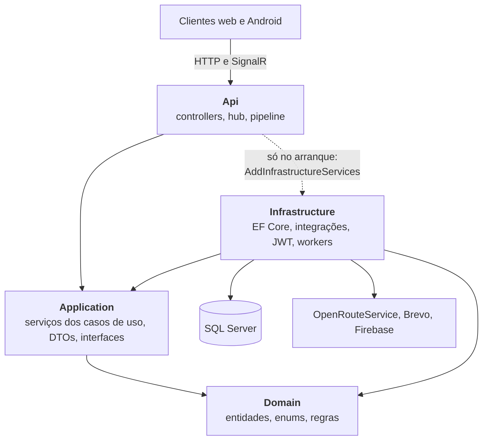
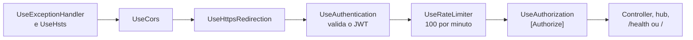
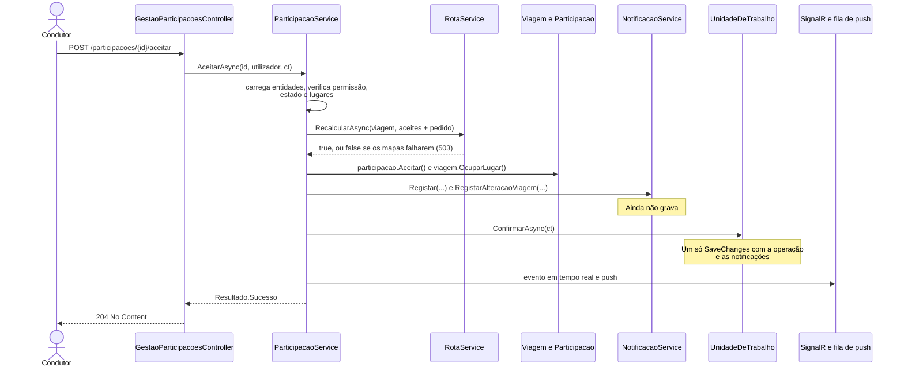
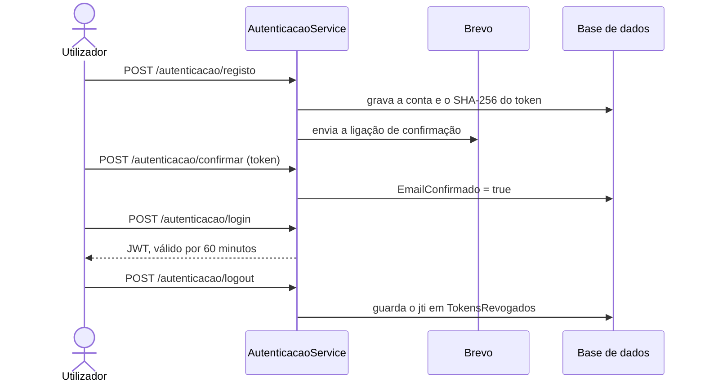
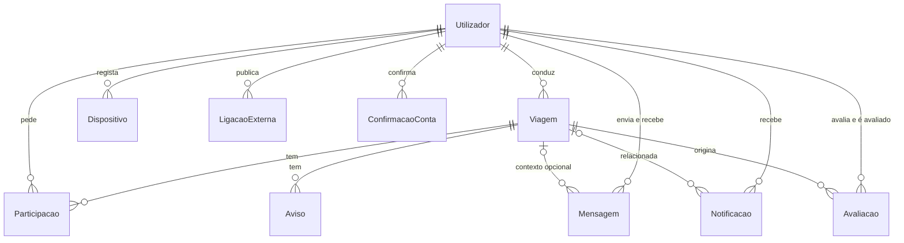
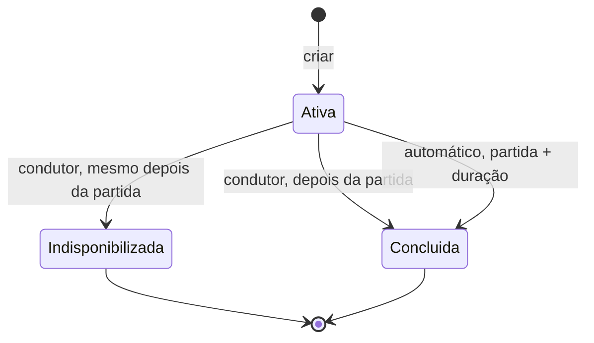
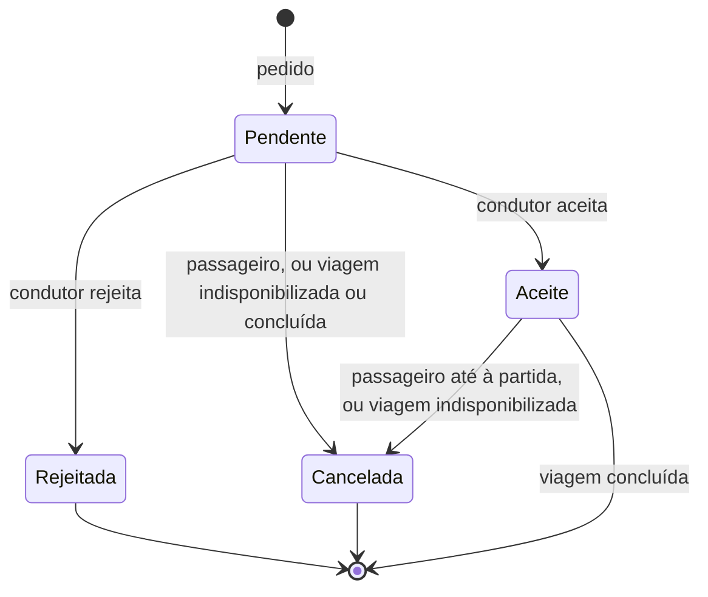

# Guia do código do backend

Para quem vai ler, corrigir ou acrescentar código ao backend do Campus Carpool sem o ter escrito. Explica como as peças encaixam e onde procurar; o detalhe de cada classe está nos comentários XML do próprio código.

Descreve o código da branch `feat/29-i110-…` depois das melhorias e da revisão final de 06/11/2026. **Quando este guia e o código divergirem, vale o código.**

**Referências usadas no texto:** `RF-Fnnn-nn`, `RNF-…` e `P-nn` são requisitos e pressupostos da especificação; `UC-Fnnn-nn` são casos de uso; `AD-001` a `AD-003` são os documentos adicionais sobre estados, rotas e permissões. `DEF-BE-nnn` são defeitos da RTM. `DC-nn`, `API-nn`, `DO-nn`, `AP-nn`, `IN-nn` e `C1` são achados da revisão do backend, e aparecem assim nos comentários do código.

## Conteúdo

1. [Mapa do código](#1-mapa-do-código)
2. [Um pedido do início ao fim](#2-um-pedido-do-início-ao-fim)
3. [Autenticação](#3-autenticação)
4. [Notificações e tempo real](#4-notificações-e-tempo-real)
5. [Modelo de dados e entidades](#5-modelo-de-dados-e-entidades)
6. [Ciclo de vida da viagem e da participação](#6-ciclo-de-vida-da-viagem-e-da-participação)
7. [Rotas e Serviço de Mapas](#7-rotas-e-serviço-de-mapas)
8. [Onde está cada funcionalidade](#8-onde-está-cada-funcionalidade)
9. [Armadilhas](#9-armadilhas)
10. [Limitações conhecidas](#10-limitações-conhecidas)
11. [Como correr](#11-como-correr)
12. [Como testar](#12-como-testar)
13. [Frontend mobile](#13-frontend-mobile)

## 1. Mapa do código

Todo o código está em `backend/`, numa solução .NET 10 (`CampusCarpool.slnx`) com quatro projetos em `src/` e um de testes em `tests/`.



| Camada | O que tem | Pastas |
|---|---|---|
| **Domain** | Entidades com as suas transições de estado, enums, `RegraDeNegocioException` e regras puras. Não depende de nada | `Entities/`, `Enums/`, `Exceptions/`, `Rules/` |
| **Application** | Um módulo por área, cada um com interface, serviço e DTOs. Define as interfaces de que precisa (repositórios e integrações), mas não as implementa | `Identidade/`, `Viagens/`, `Participacoes/`, `Comunicacao/`, `Notificacoes/`, `Avaliacoes/`, `Rotas/`, `Historico/`, `Comum/`, `Abstractions/` |
| **Infrastructure** | Implementa essas interfaces: EF Core, repositórios, migrations, Brevo, Firebase, OpenRouteService, JWT, hash da palavra-passe e trabalhadores em segundo plano | `Persistence/`, `Repositories/`, `Migrations/`, `Integrations/`, `Security/`, `BackgroundJobs/` |
| **Api** | Só HTTP: controllers, hub SignalR, tratamento de erros, limites de pedidos e `Program.cs` | `Controllers/`, `Hubs/`, `Middleware/`, `Configuration/` |

### As regras das camadas são testadas

`tests/CampusCarpool.Tests/Unit/ArquiteturaTests.cs` falha se alguém as quebrar:

- O Domain não conhece as outras camadas, nem EF Core, nem ASP.NET.
- A Application só conhece o Domain, sem EF Core nem ASP.NET.
- A Api não usa EF Core nem `Application.Abstractions.Persistence`. Da Infrastructure só conhece `InfrastructureServiceRegistration`, e do `Domain.Entities` só `Coordenadas`.

Na prática: **um controller nunca toca na base de dados nem devolve uma entidade**. Lê o utilizador do token, verifica o formato, chama um serviço e traduz o resultado.

### Onde ponho isto?

| Quero acrescentar… | Vai para |
|---|---|
| Uma regra sobre o estado de uma entidade | Método da entidade, em `Domain/Entities/` |
| Uma regra pura, sem estado | `Domain/Rules/` |
| Um caso de uso | `Application/<Modulo>/`: interface `I…Service` e implementação, registadas em `ApplicationServiceRegistration` |
| O corpo de uma resposta | Record em `Application/<Modulo>/Dtos<Modulo>.cs`; os poucos que só existem em HTTP ficam em `Api/Controllers/Respostas.cs` |
| O corpo de um pedido | Record aninhado no controller |
| Uma consulta à base de dados | Método em `Application/Abstractions/Persistence/` e a implementação em `Infrastructure/Repositories/` |
| Um serviço externo | Interface em `Application/Abstractions/Integrations/`, implementação em `Infrastructure/Integrations/`, registo em `InfrastructureServiceRegistration` |
| Trabalho periódico | Trabalhador em `Infrastructure/BackgroundJobs/`; a lógica fica num serviço da Application |
| Uma opção de configuração | Classe `Opcoes…` na Application, ligada no `Program.cs`. A Application nunca lê `IConfiguration` |
| Uma alteração ao esquema | `CampusCarpoolDbContext.OnModelCreating` e uma migration ([§5](#migrations)) |

### Acrescentar um endpoint, passo a passo

1. Escrever o teste ([§12](#12-como-testar)) e, se a rota cruzar o pipeline, usar a `AplicacaoReal`.
2. Pôr a regra na entidade ou em `Domain/Rules/`, se for regra de negócio.
3. Se faltar uma consulta, acrescentá-la ao repositório, incluindo os falsos de `I052ParticipacaoServiceTests`.
4. Acrescentar o método ao serviço. Devolve `Resultado` ou `Resultado<T>` ([§2](#erros-três-caminhos)).
5. Definir o DTO da resposta.
6. Acrescentar a ação ao controller. A rota exige sessão por omissão; só uma rota pública leva `[AllowAnonymous]` ([§9](#segurança)).
7. Atualizar o `ContratoRespostasHttpTests` se a resposta for nova, e os comentários XML que citem requisitos.

## 2. Um pedido do início ao fim

### O pipeline

O `Program.cs` monta os passos por esta ordem. A ordem importa: o tratamento de exceções apanha tudo o que vem depois, e o limitador vem depois da autenticação para contar por utilizador.



### Exemplo: aceitar um pedido

`POST /api/v1/participacoes/{id}/aceitar` mostra o padrão de quase todas as operações que alteram dados.



O padrão tem quatro passos, descritos no início de `ParticipacaoService`:

1. Carregar as entidades, com seguimento do EF.
2. Verificar a permissão e o estado, para devolver o erro certo a cada caso.
3. Alterar as entidades, registar as notificações e gravar tudo de uma vez com `IUnidadeDeTrabalho.ConfirmarAsync`.
4. **Só depois** enviar o evento em tempo real e o push, com `CancellationToken.None`: a operação já aconteceu, mesmo que o cliente desligue entretanto.

Assim nunca se anuncia uma operação que falhou nem se grava uma operação sem a sua notificação.

### Erros: três caminhos

| Situação | Como sai do serviço | Quem traduz | Resposta |
|---|---|---|---|
| Erro previsto (dados inválidos, sem permissão, estado que não permite) | `Resultado` com um `Erro` | `Api/Controllers/RespostasHttp.cs` | Sempre `{ "erro": "…" }` |
| Conflito ao gravar, ou transição inválida numa entidade | `RegraDeNegocioException` | `GlobalExceptionHandler` | 409 `ProblemDetails`, com a mensagem em `detail` e em `erro` |
| Qualquer outra exceção | Exceção | `GlobalExceptionHandler` | 500 `ProblemDetails` com texto genérico, também em `erro`; o detalhe fica só no log |

Um serviço escreve simplesmente `return new Erro(TipoErro.Conflito, "Viagem indisponível.")` ou `return valor`: as conversões implícitas de `Resultado<T>` tratam do resto. O controller responde com `this.Responder(resultado, valor => Ok(valor))`.

`RespostasHttp.cs` é o único sítio que associa um tipo de erro a um código HTTP:

| `TipoErro` | HTTP | Quando |
|---|---|---|
| `DadosInvalidos` | 400 | Os dados não cumprem as regras |
| `NaoAutenticado` | 401 | Credenciais inválidas |
| `Proibido` | 403 | Sem permissão |
| `NaoEncontrado` | 404 | Não existe, ou o utilizador não o pode ver |
| `Conflito` | 409 | O estado atual não permite a operação |
| `NaoProcessavel` | 422 | Bem formado, mas sem correspondência (um local desconhecido) |
| `FalhaServicoExterno` | 502 | Um serviço externo respondeu com erro |
| `ServicoIndisponivel` | 503 | Um serviço externo não está disponível nem configurado |
| `TempoEsgotado` | 504 | Um serviço externo não respondeu a tempo |

As entidades também verificam as transições, mas os serviços verificam antes. Se uma entidade lançar `RegraDeNegocioException` durante uma operação normal, o serviço deixou passar um caso.

**Onde fica cada validação:** o controller trata do formato (paginação, campos em branco que dão resposta sem corpo); as regras ficam nos serviços.

## 3. Autenticação



- **Registo:** só aceita domínios de `EmailAcademico:Dominios` (`ValidadorEmailAcademico`); com a lista vazia recusa todos. Palavra-passe de 8 ou mais caracteres, com letra e dígito (P-08).
- **Confirmação:** a ligação vale 24 horas (P-02). Na base de dados fica só o SHA-256 do token. Sem conta confirmada não há login.
- **JWT:** HS256, 60 minutos, com as claims `sub` (id do utilizador) e `jti`. Não há refresh token. A tolerância de relógio é de 30 segundos (P-17).
- **Logout:** `OnTokenValidated` chama `ValidacaoTokensRevogados` em cada pedido autenticado, que recusa tokens revogados e tokens sem `jti`. Aplica-se também ao hub. Uma ligação ao hub já aberta não é fechada no logout.
- **Quem é o utilizador:** o controller lê-o com `User.IdUtilizador()`. Nenhuma rota recebe a identidade no corpo do pedido.
- **Limites (`LimitesPedidos`):** 100 pedidos por minuto, por utilizador ou por IP, e 10 por minuto por IP no login, registo e reenvio da confirmação. Acima disso, 429.

## 4. Notificações e tempo real

Há três canais, e nem todos os tipos usam todos:

| `TipoNotificacao` | Quando | Na lista de notificações | Evento SignalR | Push Android |
|---|---|---|---|---|
| `PedidoRecebido` | Um passageiro faz um pedido | Sim | Sim | Sim |
| `PedidoAceite` | O condutor aceita | Sim | Sim | Sim |
| `PedidoRejeitado` | O condutor rejeita | Sim | Sim | Sim |
| `AlteracaoViagem` | Alteração ou indisponibilização da viagem; outro passageiro aceite ou cancelado | Sim | Não | Não |
| `Aviso` | Aviso do condutor | Sim | Não | Não |
| `NovaMensagem` | Mensagem recebida | Sim | Não | Não |

Cancelar um pedido pendente não notifica ninguém (P-21). Concluir uma viagem também não.

- **`Registar*` não grava.** Os métodos de `INotificacaoService` juntam a notificação às alterações pendentes, para ficar na mesma gravação da operação. Quem os chama é que confirma.
- **P-23 está num só sítio.** `RegistarAlteracaoViagem` notifica o condutor e os passageiros indicados, exceto quem originou a alteração.
- **Tempo real:** `INotificadorPedidosTempoReal` (Application) é implementado por `NotificadorPedidosSignalR` (Api). O hub `/hubs/pedidos` não tem métodos: o cliente só recebe eventos com o nome do tipo e o corpo `{ pedidoId }`, e vai buscar os detalhes por HTTP. O WebSocket não envia cabeçalhos, por isso o JWT segue em `?access_token=`, aceite só neste caminho.
- **Push:** `EnviarPushAsync` coloca a mensagem em `FilaNotificacoesPush`, em memória. `TrabalhadorNotificacoesPush` lê a fila e chama `ServicoPush` (Firebase). Uma falha fica no log e não se tenta de novo.

## 5. Modelo de dados e entidades

Cada entidade de `Domain/Entities/` é uma tabela de `CampusCarpoolDbContext`. Todo o mapeamento está em `OnModelCreating`.



| Entidade | Tabela | Para quê | Notas |
|---|---|---|---|
| `Utilizador` | `Utilizadores` | Conta | Email único. A classificação média não é guardada: calcula-se (`CalculadoraDeClassificacao`) |
| `ConfirmacaoConta` | `ConfirmacoesConta` | Token de confirmação | Só o hash |
| `TokenRevogado` | `TokensRevogados` | `jti` de sessões terminadas | Sem chave estrangeira; os expirados são apagados no logout seguinte |
| `Viagem` | `Viagens` | Oferta do condutor | Estado em texto, rota em JSON, `Versao` para concorrência, colunas de pesquisa |
| `Participacao` | `Participacoes` | Pedido de um passageiro | Índice único filtrado: um só pedido `Pendente` ou `Aceite` por passageiro e viagem; `Versao` para concorrência |
| `Avaliacao` | `Avaliacoes` | Classificação entre participantes | Índice único no par `(AvaliadorId, AvaliadoId)`, seja qual for a viagem |
| `Mensagem` | `Mensagens` | Mensagem individual | `ViagemId` opcional |
| `Aviso` | `Avisos` | Aviso do condutor | Até 100 caracteres |
| `Notificacao` | `Notificacoes` | Notificação pessoal | Título e conteúdo são copiados ao criar |
| `Dispositivo` | `Dispositivos` | Token Android para push | Chama-se `PushToken` no modelo de dados |
| `LigacaoExterna` | `LigacoesExternas` | Ligação pública do perfil | No modelo de dados é a coluna JSON `ligacoes_externas` do utilizador |

Em relação ao modelo de dados, há mais uma diferença: `Utilizador` usa `EmailConfirmado` em vez de `estado_conta`.

`Coordenadas`, `LocaisViagem` e `PontoRota` também estão em `Entities/`, mas não são tabelas. Não há eliminação em cascata, e as viagens nunca são apagadas (RF-F002-14).

### Entidades que se protegem

Os `set` do estado, dos lugares e da rota são `internal`: a Application só os muda pelos métodos da entidade (`Viagem.Indisponibilizar`, `Participacao.Aceitar`…). Os testes montam cenários através de `InternalsVisibleTo`.

### Migrations

Ficam em `Infrastructure/Migrations/` e **nunca se aplicam ao arrancar a API** ([§11](#base-de-dados)). Qualquer alteração ao `OnModelCreating` exige uma nova:

```powershell
dotnet ef migrations add <Nome> --project src/CampusCarpool.Infrastructure --startup-project src/CampusCarpool.Api
dotnet ef migrations has-pending-model-changes --project src/CampusCarpool.Infrastructure --startup-project src/CampusCarpool.Api
```

**Migrations à mão:** o SQL Server não altera uma coluna usada por um `CHECK` ou por um índice filtrado, e um `migrations add` não trata disso: ver `I110_TamanhosERestricoes`. Um preenchimento de dados vai dentro de `EXEC`, porque num script único o lote seria compilado antes de a coluna existir. A CI aplica as migrations em SQL Server real; localmente, sem SQL Server, os testes correm em SQLite com o esquema do modelo.

## 6. Ciclo de vida da viagem e da participação

As transições estão nas entidades e seguem o AD-001.

### Viagem



- **Indisponibilizar:** liberta todos os lugares, cancela pedidos pendentes e participações aceites, e notifica os afetados.
- **Concluir:** cancela os pendentes e mantém os aceites, para o histórico e as avaliações. A conclusão automática corre em `TrabalhadorConclusaoViagens`, a cada `ConclusaoViagens:IntervaloSegundos` (60 por omissão). Cada viagem é gravada à parte, para uma falha não travar as outras.

Cada operação tem a sua condição. **Não são todas iguais**, e isso é propositado:

| Operação | Condição | Método |
|---|---|---|
| Fazer um pedido | Ativa e ainda por partir | `Viagem.PorPartir` |
| Alterar a viagem | Ativa e ainda por partir | `Viagem.PorPartir` |
| Aceitar ou simular um pedido | Ativa, **mesmo depois da partida** (RF-F004-10) | `Viagem.EstaAtiva` |
| Indisponibilizar | Ativa | `Viagem.EstaAtiva` |
| Concluir manualmente | Ativa e já partida | `Viagem.PodeConcluir` |
| Conclusão automática | Ativa e terminada a duração estimada | `Viagem.DeveConcluir` |
| Aparecer na pesquisa | Ativa, por partir e com lugares | `Viagem.EstaDisponivelParaPesquisa` |

### Participação



- **Só o passageiro cancela.** O condutor rejeita pendentes ou indisponibiliza a viagem; não retira um passageiro aceite (AD-001).
- **Só as participações aceites ocupam lugares.** `LugaresDisponiveis` é oferecidos menos aceites, e a operação é recusada se a contagem não bater certo (`Viagem.LugaresConsistentes`).
- **`Participacao.AceiteEm` não se apaga.** Mantém no histórico do passageiro as viagens indisponibilizadas depois da aceitação.
- Pode haver um novo pedido depois de um cancelado ou rejeitado: o índice único só conta `Pendente` e `Aceite`.

## 7. Rotas e Serviço de Mapas

A rota da viagem fica guardada em `Viagem.RotaPontos`, em JSON (formato em `Application/Rotas/RotaGuardada.cs`). Consultar uma rota não chama o Serviço de Mapas; só se chama quando a rota muda. **`null` significa «por recalcular»** (P-19).

| Operação | O que acontece à rota | Se os mapas falharem |
|---|---|---|
| Criar a viagem | Calcula e guarda a rota direta | 502, 503 ou 504; a viagem não é criada |
| Alterar a viagem | Recalcula antes de mexer na viagem | Erro; a viagem fica como estava |
| Aceitar um pedido | Recalcula com o novo passageiro | 503; nada muda |
| Cancelar uma participação aceite | Recalcula sem o passageiro | **Nunca é recusado**: a rota fica a `null` |
| Indisponibilizar | Recalcula sem passageiros | **Nunca é recusado**: a rota fica a `null` |
| Consultar a viagem (`GET /viagens/{id}`) | Lê a guardada; se for `null`, calcula e grava | Responde na mesma, com o motivo em vez da estimativa |
| Consultar a rota (`GET /rotas/viagens/{viagemId}`) | Lê a guardada; se for `null`, calcula e grava | 502, 503 ou 504 |
| Simular | Calcula sem gravar | 502, 503 ou 504 |

- **Ordem dos pontos:** `RotaService` pede uma matriz de distâncias à Matrix API, uma só chamada, e `OrdenadorDePontos` escolhe a sequência exata de P-07, com a recolha de cada passageiro antes do seu destino.
- **Distância e duração:** `DistanciaKm` acompanha a rota atual. `DuracaoMinutos` fica com o valor da criação ou da última alteração (P-04), porque é a base da conclusão automática.
- **Custo:** `EstimativaCustoService` usa `CalculadoraDeCusto` e `Custos:PrecoPorKm`.
- **Falhas:** `Application/Rotas/ChamadaMapas.cs` traduz as exceções de rede em erros 502 e 504; sem `Maps:ApiKey`, 503. Uma resposta sem o formato esperado conta como erro do serviço (502), e um 404 do ORS com o código 2009 ou 2010 significa que não há rota (422).
- **Privacidade:** só o condutor e os passageiros aceites veem os pontos (`PoliticaDeVisibilidade`, P-13). Quem pode consultar a viagem está em `ConsultaViagensService`.
- **Mesmo local:** `RegraMesmoLocal` compara o texto normalizado ou as coordenadas (glossário da especificação).

## 8. Onde está cada funcionalidade

Todas as rotas começam por `/api/v1`. Os requisitos e os casos de uso vêm da RTM. Consultar a [§10](#10-limitações-conhecidas) para o que ainda tem limitações.

### F001: registo, autenticação e perfil

| Rota | Requisitos | Caso de uso | Controller → serviço |
|---|---|---|---|
| `POST /autenticacao/registo` | RF-F001-02 a 06 | UC-F001-01 | `AutenticacaoController` → `AutenticacaoService` |
| `POST /autenticacao/confirmar` | RF-F001-07, 08 | UC-F001-02 | `AutenticacaoController` → `AutenticacaoService` |
| `POST /autenticacao/reenviar-confirmacao` | RF-F001-21 | UC-F001-03 | `AutenticacaoController` → `AutenticacaoService` |
| `POST /autenticacao/login` | RF-F001-10, 11 | UC-F001-04 | `AutenticacaoController` → `AutenticacaoService` |
| `POST /autenticacao/logout` | RF-F001-12, RF-F006-18 | UC-F001-05 | `AutenticacaoController` → `AutenticacaoService` |
| `GET /autenticacao/me` | Apoio ao frontend, sem requisito | — | `AutenticacaoController` |
| `GET /utilizadores/me` | RF-F001-20 | UC-F001-06 | `UtilizadoresController` → `PerfilService` |
| `PUT /utilizadores/me` | RF-F001-14, 18 | UC-F001-07 | `UtilizadoresController` → `PerfilService` |
| `POST /utilizadores/me/ligacoes` | RF-F001-15, 16 | UC-F001-08 | `UtilizadoresController` → `PerfilService` |
| `DELETE /utilizadores/me/ligacoes/{ligacaoId}` | RF-F001-22 | UC-F001-09 | `UtilizadoresController` → `PerfilService` |
| `GET /utilizadores/{id}` | RF-F001-17, 19, RF-F007-10 | UC-F001-10 | `UtilizadoresController` → `PerfilService` |

Exigência de sessão (RF-F001-13): `[Authorize]` nos controllers e `ValidacaoTokensRevogados`.

### F002: criação e gestão de viagens

| Rota | Requisitos | Caso de uso | Controller → serviço |
|---|---|---|---|
| `POST /viagens` | RF-F002-01 a 06, 17 | UC-F002-01 | `ViagensController` → `ViagemService` |
| `GET /viagens/minhas` | RF-F002-15 | UC-F002-02 | `ViagensController` → `ViagemService` |
| `PUT /viagens/{id}` | RF-F002-07, 08, 11, 16, 17, RF-F006-04 | UC-F002-03 | `ViagensController` → `ViagemService` |
| `POST /viagens/{id}/indisponibilizar` | RF-F002-09 a 11, RF-F006-03 | UC-F002-04 | `ViagensController` → `ViagemService` |
| `POST /viagens/{id}/concluir` | RF-F004-19 | UC-F002-05 | `ViagensController` → `ViagemService` |
| Sem rota: conclusão automática | RF-F002-12, RF-F004-19 | UC-F002-05 | `TrabalhadorConclusaoViagens` → `ConclusaoViagensService` |

As viagens nunca são apagadas (RF-F002-14): não há rota `DELETE`.

### F003: pesquisa e consulta

| Rota | Requisitos | Caso de uso | Controller → serviço |
|---|---|---|---|
| `GET /pesquisa/viagens` | RF-F003-01 a 05 | UC-F003-01 | `PesquisaController` → `PesquisaService` |
| `GET /viagens/{id}` | RF-F003-03, 04, 06 | UC-F003-02 | `ViagensController` → `ViagemService`, `ConsultaViagensService` |
| `GET /viagens/{id}/passageiros` | RF-F003-07 | UC-F003-02 | `ViagensController` → `ViagemService` |
| `GET /rotas/viagens/{viagemId}` | RF-F003-08 | UC-F003-02 | `RotasController` → `ConsultaRotasService` |

### F004: pedido e gestão de participação

| Rota | Requisitos | Caso de uso | Controller → serviço |
|---|---|---|---|
| `POST /pedidos` | RF-F004-01, 02, 05 a 07, 13, 18, 20, 21, RF-F006-13, 15 | UC-F004-01 | `PedidosController` → `ParticipacaoService` |
| `GET /viagens/{id}/pedidos` | RF-F004-08 | UC-F004-02 | `ViagensController` → `ViagemService` |
| `POST /viagens/{viagemId}/simulacao` | RF-F004-04, 09, RF-F008-06 | UC-F004-03 | `SimulacoesController` → `ParticipacaoService` |
| `POST /participacoes/{id}/aceitar` | RF-F004-10, 11, RF-F002-13, RF-F006-01, 14 | UC-F004-04 | `GestaoParticipacoesController` → `ParticipacaoService` |
| `POST /participacoes/{id}/rejeitar` | RF-F004-12, RF-F006-01 | UC-F004-05 | `GestaoParticipacoesController` → `ParticipacaoService` |
| `POST /participacoes/{id}/cancelar` | RF-F004-15 a 17, RF-F006-02, 14 | UC-F004-07, 08 | `GestaoParticipacoesController` → `ParticipacaoService` |

O passageiro consulta os seus pedidos (RF-F004-14, UC-F004-06) em `GET /historico`.

### F005: comunicação

| Rota | Requisitos | Caso de uso | Controller → serviço |
|---|---|---|---|
| `POST /mensagens` | RF-F005-01, 02, RF-F006-06 | UC-F005-01 | `MensagensController` → `MensagemService` |
| `GET /mensagens/conversas` | RF-F005-08 | UC-F005-02 | `MensagensController` → `MensagemService` |
| `GET /mensagens/conversa/{outroUtilizadorId}` | RF-F005-04, 09 | UC-F005-03 | `MensagensController` → `MensagemService` |
| `POST /viagens/{viagemId}/avisos` | RF-F005-05, 07, 10, RF-F006-05, 17 | UC-F005-04 | `AvisosController` → `AvisoService` |
| `GET /viagens/{viagemId}/avisos` | RF-F005-06 | UC-F005-05 | `AvisosController` → `AvisoService` |

### F006: notificações

| Rota | Requisitos | Caso de uso | Controller → serviço |
|---|---|---|---|
| `GET /notificacoes` | RF-F006-07 | UC-F006-01 | `NotificacoesController` → `NotificacaoService` |
| `PUT /notificacoes/{id}/ler` | RF-F006-19 | UC-F006-01 | `NotificacoesController` → `NotificacaoService` |
| `PUT /notificacoes/ler-todas` | RF-F006-19 | UC-F006-01 | `NotificacoesController` → `NotificacaoService` |
| `POST /dispositivos` | RF-F006-10 | UC-F006-02 | `DispositivosController` → `DispositivoService` |
| `DELETE /dispositivos` | RF-F006-18 | UC-F006-02 | `DispositivosController` → `DispositivoService` |
| Hub `/hubs/pedidos` (fora de `/api/v1`) | RF-F006-09, 15 | UC-F006-03 | `PedidosHub`, `NotificadorPedidosSignalR` |
| Sem rota: push | RF-F006-11, 12, 16, 17 | UC-F006-03 | `NotificacaoService` → `FilaNotificacoesPush` → `TrabalhadorNotificacoesPush` → `ServicoPush` |

### F007: avaliações

| Rota | Requisitos | Caso de uso | Controller → serviço |
|---|---|---|---|
| `POST /avaliacoes` | RF-F007-01 a 04 | UC-F007-01 | `AvaliacoesController` → `AvaliacaoService` |
| `PUT /avaliacoes/utilizadores/{avaliadoId}` | RF-F007-05 | UC-F007-02 | `AvaliacoesController` → `AvaliacaoService` |
| `GET /avaliacoes/utilizadores/{utilizadorId}` | RF-F007-07 a 11 | UC-F007-03 | `AvaliacoesController` → `AvaliacaoService` |

### F008: mapas, rotas e custo

| Rota | Requisitos | Caso de uso | Controller → serviço |
|---|---|---|---|
| `GET /rotas/geocodificar` | RF-F008-01 | — | `RotasController` → `ConsultaRotasService` |
| `POST /rotas/calcular` | RF-F008-02 | — | `RotasController` → `ConsultaRotasService` |
| `GET /rotas/viagens/{viagemId}` | RF-F008-03, 04, 09, 10 | UC-F008-01, 02 | `RotasController` → `ConsultaRotasService` |
| Sem rota própria: recálculo | RF-F008-05 | UC-F002-03, UC-F004-04 | `RotaService`, `OrdenadorDePontos`, `ServicoMapasRotas` |
| Sem rota própria: estimativa de custo | RF-F008-10 | UC-F008-02 | `EstimativaCustoService`, `CalculadoraDeCusto` |

As falhas do serviço (RF-F008-12) passam por `ChamadaMapas`.

### F009: histórico

| Rota | Requisitos | Caso de uso | Controller → serviço |
|---|---|---|---|
| `GET /historico` | RF-F009-01 a 08, RF-F004-14 | UC-F009-01, 02, UC-F004-06 | `HistoricoController` → `HistoricoService` → `RepositorioHistorico` |

### Fora das funcionalidades

`GET /` e `GET /health` são anónimos. `GET /` só indica que o processo responde; `GET /health` faz uma consulta à base de dados e responde 503 se ela falhar.

## 9. Armadilhas

### Base de dados e EF Core

- **`Listar…` não muda nada.** Os métodos `ListarPorViagemAsync` e semelhantes usam `AsNoTracking`: alterar o que devolvem não é gravado. Para alterar, usar `ObterPorIdAsync` ou `Listar…ParaAlterarAsync`.
- **Nem tudo espera pelo `ConfirmarAsync`.** Três repositórios gravam sozinhos: participações (pedido novo) e avaliações, porque têm de reconhecer a recusa da base de dados, e dispositivos, por ser uma operação isolada. No pedido novo, a notificação registada antes entra nessa gravação.
- **Concorrência na viagem e na participação.** A coluna `Versao` só é controlada em SQL Server (`Database.IsSqlServer()` no `OnModelCreating`); em SQLite não é. A segunda gravação falha e chega ao cliente como 409.
- **O estado da viagem é `Concluida`, sem acento.** Fica em texto, e `CK_Viagens_Estado` recusa outros valores. Mudar o nome de um membro de `EstadoViagem`, `EstadoParticipacao` ou `TipoNotificacao` exige uma migration de dados.
- **Colunas de pesquisa.** `OrigemPesquisa`, `DestinoPesquisa` e `PartidaMinutoDoDia` são preenchidas pelo próprio `DbContext` ao gravar. Não as escrever à mão.
- **Tamanhos e `CHECK`.** Seguem o modelo de dados v06. Um limite novo numa coluna tem de existir também no serviço, para dar 400 e não 500.

### Datas

- As colunas são `datetime2` e guardam sempre UTC. O `ConversorDataUtc` faz as datas lidas saírem com `Kind = Utc`, por isso a API devolve-as com `Z`.
- A API só aceita datas com `Z`: uma partida sem `Z`, ou com um desvio como `+01:00`, dá 400. O `toISOString()` do JavaScript já envia `Z`.
- Os filtros `data` e `hora` da pesquisa são os do relógio de Portugal (`HoraDePortugal`), não UTC.

### JSON e testes

- O JSON da API é camelCase, mas os records têm propriedades PascalCase. Um teste que serialize `result.Value` tem de usar `JsonSerializerDefaults.Web`.
- Um `Erro` tem sempre mensagem: o tipo exige-a (RNF-USA-02).
- Todos os erros da API têm o campo `erro` ([§2](#erros-três-caminhos)), incluindo os 400 de corpo inválido e os 429. A exceção é o 401 do JwtBearer, sem corpo.

### Segurança

- **Autorização por omissão:** uma rota nova exige sessão. Uma rota pública tem de ter `[AllowAnonymous]` e entrar na lista do `RotasProtegidasHttpTests`, que percorre as rotas da aplicação. Sem sessão, uma rota inexistente dá 401, não 404.
- **CORS:** as origens do browser vêm de `Cors:Origens`. Fora dessa lista, o browser não chama a API.
- **Nunca pôr segredos no repositório:** é público. O `appsettings.json` não tem `Jwt:Key`, de propósito. Nas coleções Postman também não vão emails, palavras-passe nem tokens reais.

### Configuração e documentos antigos

- `Maps:BaseUrl` e `Maps:Provider` não têm efeito: `ServicoMapasRotas` usa URLs absolutos (IN-04).
- O nome certo da ligação à base de dados é `ConnectionStrings:DefaultConnection`. O `README.md` e o `database/scripts/README.md` ainda dizem `ConnectionStrings__CampusCarpool`.
- `docs/IMPLEMENTACAO-STATUS.md` está desatualizado: confirmar sempre no código.
- A 06/11/2026, a API publicada em Azure ainda era anterior à I110: `POST /autenticacao/logout` e `GET /mensagens/conversas` davam 404.

## 10. Limitações conhecidas

Estão também marcadas nos comentários do código, com o mesmo identificador.

| Id | Limitação | Consequência |
|---|---|---|
| AP-07 | Fila de push em memória, aceite no MVP (G17) | Um reinício perde os pushes por enviar; as notificações ficam na base de dados |
| AP-10 | Histórico e conversa sem paginação | Respostas grandes em contas com muito uso |
| DC-46 | JWT na query string do hub | Pode ficar nos logs de acesso |
| IN-04 | `Maps:BaseUrl` sem efeito | Mudar o fornecedor exige alterar o código |
| — | Ligação ao hub não fecha logo no logout | Continua a receber eventos até o token expirar, no máximo 60 minutos |

## 11. Como correr

Comandos a partir de `backend/`. É preciso o SDK do .NET 10 (`global.json`) e um SQL Server: LocalDB, contentor ou remoto. O manual completo é o [I064](../operacao/I064-MANUAL-INSTALACAO-BACKEND.md).

### Configuração

Em desenvolvimento, usar User Secrets:

```powershell
dotnet user-secrets set "Jwt:Key" "<CHAVE_COM_32_OU_MAIS_BYTES>" --project src/CampusCarpool.Api
dotnet user-secrets set "ConnectionStrings:DefaultConnection" "<CONNECTION_STRING>" --project src/CampusCarpool.Api
```

Em produção, variáveis de ambiente: `Jwt__Key`, `ConnectionStrings__DefaultConnection`…

| Chave | Obrigatória? | Sem ela |
|---|---|---|
| `Jwt:Key` (32 bytes ou mais) | **Sim** | A API não arranca |
| `ConnectionStrings:DefaultConnection` | **Sim** | A API não arranca. O `appsettings.json` traz o LocalDB por omissão |
| `Jwt:Issuer`, `Jwt:Audience` | No `appsettings.json` | — |
| `EmailAcademico:Dominios` | No `appsettings.json` | Lista vazia recusa todos os registos |
| `Maps:ApiKey` | Para quase tudo | Criar ou alterar viagens e fazer pedidos dá 503 |
| `Brevo:ApiKey`, `Brevo:FromEmail`, `Frontend:ConfirmUrl` | Para registar | A conta é criada, mas o registo responde 503 |
| `Firebase:ProjectId`, `Firebase:ClientEmail`, `Firebase:PrivateKey` | Não | O push não é enviado; fica um aviso no log |
| `Custos:PrecoPorKm` | No `appsettings.json` | — |
| `Cors:Origens` | No `appsettings.json` traz `http://localhost:4200`; em produção, o endereço do frontend | O browser não chama a API |
| `ConclusaoViagens:IntervaloSegundos` | Não | 60 segundos |

Sem Brevo não há como receber o token de confirmação. Numa base de dados **de desenvolvimento**, pôr `EmailConfirmado = 1` diretamente no utilizador.

### Base de dados

As migrations aplicam-se à parte, antes de arrancar:

```powershell
dotnet tool install --global dotnet-ef --version 10.0.*
dotnet ef database update --project src/CampusCarpool.Infrastructure --startup-project src/CampusCarpool.Api
```

### Arrancar

```powershell
dotnet run --project src/CampusCarpool.Api
```

O OpenAPI só existe em `Development`, em `/openapi/v1.json`. Para ver se a API responde, usar `GET /health`.

## 12. Como testar

```powershell
dotnet test CampusCarpool.slnx
dotnet test --filter "FullyQualifiedName~ViagemTests"
pwsh scripts/testes-completos.ps1
```

O script `testes-completos.ps1` faz build, formato e testes com cobertura, e avisa se os testes de SQL Server vão ficar saltados.

### Que tipo de teste escrever

| Quero testar… | Usar | Exemplos |
|---|---|---|
| Uma regra ou uma entidade | Teste unitário em `Unit/` | `ViagemTests`, `OrdenadorDePontosTests` |
| Um serviço ou um controller com base de dados | `ServicosDeTeste` sobre SQLite em memória | `ParticipacoesGestaoIntegrationTests` |
| Algo que cruza o pipeline: autenticação, limites, erros, hub | `AplicacaoReal`, com o `Program.cs` verdadeiro | `AutenticacaoRealHttpTests`, `PipelineHttpTests` |
| Algo que só o SQL Server faz | `[SqlServerFact]` | `RegrasSqlServerTests`, `MigracoesSqlServerTests` |

- **Só se falsificam as peças externas.** `ServicosFalsos.cs` tem os falsos e `ServicosDeTeste` monta os serviços reais.
- **`AplicacaoReal`:** os limites de pedidos estão ativos, por isso usar uma instância por teste. A janela é de um minuto e o SQL Server na CI é muito mais lento do que o SQLite: um teste que dependa da janela não pode fazer dezenas de pedidos em série (ver `I110_45`).
- **Fixtures:** as participações precisam de coordenadas, e a origem e o destino de uma viagem têm de ter coordenadas diferentes, senão a regra do mesmo local dá 400.
- **Mapas:** com `MapasFalsos` configurado, consultar uma viagem com rota pendente e aceites sem coordenadas lança `InvalidOperationException`. Se o teste não precisar de rotas, usar `CriarServico(configurado: false)`.
- **Valores inválidos de estado:** só com SQL direto.

### SQL Server nos testes

Os testes correm em SQLite, com `EnsureCreated`. Os que usam `[SqlServerFact]` precisam de um servidor e ficam saltados sem ele; os que usam `[SoSqliteFact]` ficam saltados em SQL Server. Para correr **toda** a suite em SQL Server, com o esquema das migrations:

```powershell
$env:CAMPUSCARPOOL_TESTES_SQLSERVER = "Server=(localdb)\MSSQLLocalDB;Trusted_Connection=True;TrustServerCertificate=True;"
$env:CAMPUSCARPOOL_TESTES_BD = "SqlServer"
dotnet test CampusCarpool.slnx
```

### Planos de testes dos frontends

Cada aplicação tem o seu plano, com níveis, ferramentas, ambientes, dados, responsabilidades e critérios de entrada e de saída. Os cenários ficam nas especificações, e os resultados nas pastas `03.02` e `03.03` de `projeto/03-artefactos-de-qualidade-de-produto`.

| Aplicação | Plano | Issue |
| --- | --- | --- |
| Web | `03.02-frontend-web/03.02.01-plano-de-testes/m4-plano-testes-frontend-web-v01.md` | I085 |
| Mobile | `03.03-frontend-mobile/03.03.01-plano-de-testes/m4-plano-testes-frontend-mobile-v01.md` | I090 |

No mobile, o plano distingue testes unitários (`core` e `app`, com JaCoCo e mínimo de 80 % de linhas em cada módulo), testes de sistema automáticos em emulador (Compose UI Test e Espresso, com a API real em `http://10.0.2.2:5100`) e simulação de aceitação em dispositivos reais.

### O que a CI exige

O pipeline oficial é o GitHub Actions (`.github/workflows/backend-ci.yml`), e corre em todos os pushes:

1. Build em Release.
2. `dotnet format whitespace` e `dotnet format style`, com `--verify-no-changes`.
3. Sem pacotes NuGet vulneráveis.
4. Testes com cobertura, em SQLite, com `coverage.runsettings`.
5. A mesma suite em SQL Server real, num contentor.
6. Cobertura de pelo menos 80 %, sem migrations.
7. Publicação.

Antes de enviar, correr pelo menos `pwsh scripts/testes-completos.ps1`, que repete os passos de build, formato e testes.

## 13. Frontend mobile

O cliente Android (I077, F001 na I078) está em `frontend-mobile`, em Kotlin e Jetpack Compose, para Android 10 ou superior. Os comandos e o estado das verificações estão no `README.md` dessa pasta e em `docs/frontend-mobile/evidencias/VALIDACAO.md`.

Dois módulos Gradle:

| Módulo | Conteúdo | Testes |
| --- | --- | --- |
| `core` | JVM puro: `data/remote` (Retrofit, interceptores, `ErrosApi`), `data/repository`, `data/session` (`SessaoManager`, `SessionStore`), `domain` (modelos, `ValidacaoFormularios`, `LigacaoApp`) | JUnit e MockWebServer |
| `app` | Android: `ui/<área>` (ecrãs e ViewModels), `AppNavigation`, `FabricaViewModels`, `di/AppContainer`, `AndroidSessionStore`, `ConnectivityMonitor` | Robolectric em JVM; o Keystore só em dispositivo |

Como encaixa com a API:

- **Sessão:** `POST autenticacao/login` devolve o JWT; `SessaoManager` lê `sub` e `exp` sem validar a assinatura e confirma a identidade em `GET autenticacao/me`. O token fica cifrado com AES-GCM e chave no Android Keystore.
- **Pedidos:** `AuthInterceptor` só envia o Bearer para a origem configurada. `ErroInterceptor` termina a sessão num 401, se o token do pedido ainda for o atual. Não há refresh: ao fim de 60 minutos volta-se a entrar.
- **Erros:** tudo passa por `ErrosApi`, que lê `{ erro }` e devolve `Resultado`. Os ecrãs nunca veem exceções. Para respostas 202 e 204, usar `ErrosApi.executarSemCorpo`.
- **Endereço:** propriedade Gradle `campusApiUrl` ou variável `CAMPUS_API_URL`, fixado na compilação. Tem de terminar em `/api/v1/`. HTTP só em debug e para `10.0.2.2`, `127.0.0.1` ou `localhost`.

Para acrescentar uma funcionalidade: método em `ApiService`, repositório em `data/repository`, ViewModel e ecrã em `ui/<área>`, rota em `AppNavigation`, o ViewModel em `FabricaViewModels` e as dependências em `AppContainer`. Nenhum ecrã chama a API diretamente.
